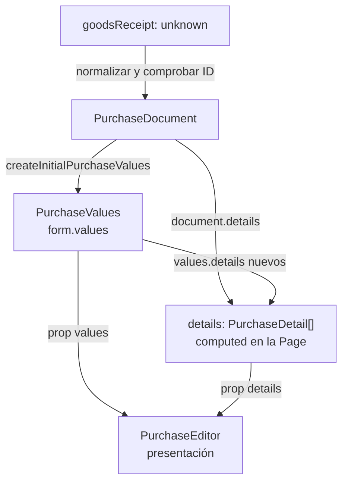
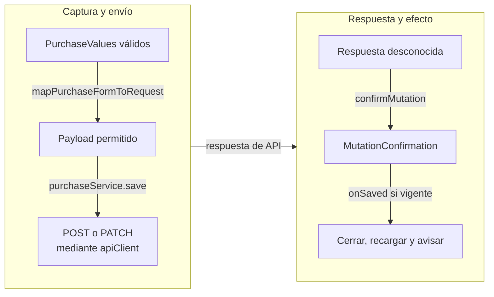

# Recorrido de los datos tipados

## Alcance y notación

Estos mapas siguen una compra real en Vue/TypeScript. Las cajas identifican datos o
consumidores; las flechas indican transformación/entrega y nombran la operación.
Complementan los diagramas de clases y las secuencias de llamadas.

## Lectura, captura y props

**Identificador:** `DIA-VUE-FLU-001`. **Pregunta:** ¿Cómo se convierte una respuesta
desconocida en datos de formulario? **Fuentes:**
[purchaseService](../../../../../src/modules/purchases/services/purchaseService.ts),
[purchaseResponseMapper](../../../../../src/modules/purchases/mappers/purchaseResponseMapper.ts),
[purchaseForm](../../../../../src/modules/purchases/purchaseForm.ts) y
[PurchaseEditorPage](../../../../../src/modules/purchases/pages/PurchaseEditorPage.vue).

**Lectura visual:** [mapas de datos y transformaciones](../../diagram-reading.md#mapas-y-actividades).

| Paso | Precisión del contrato |
| --- | --- |
| Leer | `apiClient` comprueba el contenedor general; el mapper valida campos y el servicio comprueba el ID solicitado. |
| Crear captura | Copia encabezado/observaciones y prepara `values.details = []` para detalles nuevos. |
| Mostrar detalles | La Page combina detalles persistidos y nuevos mediante `computed`. |
| Actualizar control | El componente emite; la Page conecta `editor.update` y `useFormInteraction` modifica valores con setters. |
| Conservar lectura | El editor trabaja con su captura; modificar la UI no confirma persistencia. |

El [contrato genérico](../../logical/class-and-type-models/09-reactive-contracts.md)
explica `Record<Field, Value>` y `Ref<T>`; el
[modelo de compra](../../logical/class-and-type-models/07-purchases.md), las interfaces del documento.

## Escritura y confirmación

**Identificador:** `DIA-VUE-FLU-002`. **Pregunta:** ¿Qué transforma la captura antes
de confirmar? **Fuentes:**
[purchaseRequestMapper](../../../../../src/modules/purchases/mappers/purchaseRequestMapper.ts),
`purchaseService.save`, [confirmMutation](../../../../../src/shared/http/recordContract.ts)
y `usePurchaseActions.handleSaved`. Camino confirmado: las validaciones pueden detenerlo
antes de producir el siguiente resultado. Las agrupaciones representan fases de datos;
la conexión entre ellas representa el retorno de la petición HTTP.

| Frontera | Resultado y límite |
| --- | --- |
| Captura → payload | `Record<string, unknown>` con campos seleccionados: proveedor leído en edición, fecha UTC, factura condicional, observaciones y detalles nuevos. No hay una clase `PurchaseRequest` en el código actual. |
| Red → confirmación | TypeScript no valida JSON. Un error HTTP o código inesperado interrumpe el recorrido y conserva el error. |
| Confirmación → UI | Código/mensaje comprobados; el callback actúa sólo con consumidor vigente. |
| Totales/stock | La API calcula y persiste; el cálculo previo orienta la captura. |

El [guardado compartido](../00-reading-and-roles.md#contratos-que-deben-distinguirse)
explica el callback `operation(signal)`; las
[secuencias de Compra](../06-purchases/02-purchase-save.md) desarrollan solicitud y rechazos.
