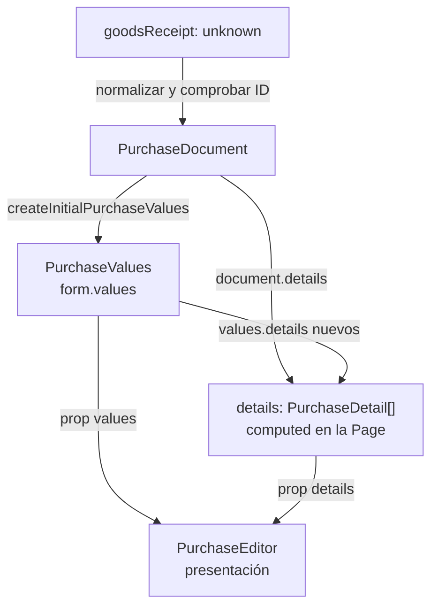
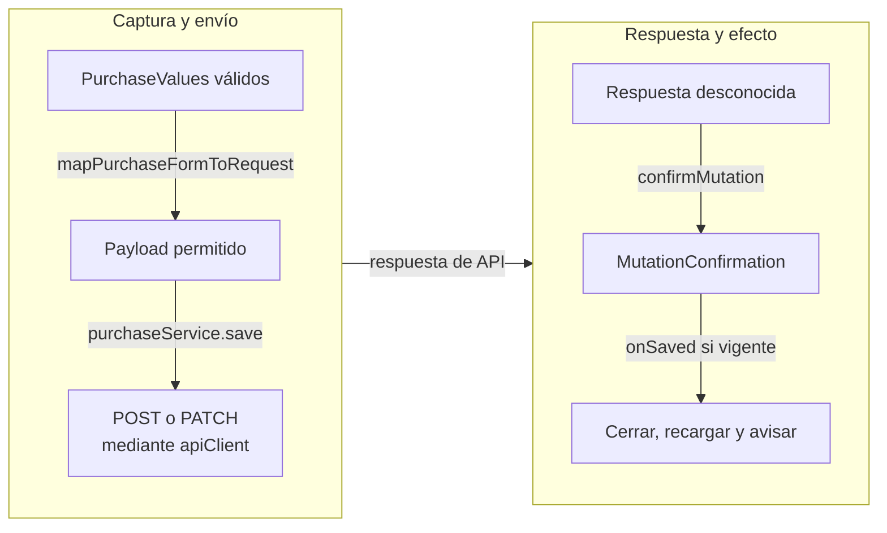

# Recorrido de los datos tipados

## Alcance y notación

Estos mapas siguen una compra real en Vue/TypeScript. Las cajas identifican datos o
consumidores; las flechas indican transformación/entrega y nombran la operación.
Complementan los diagramas de clases y las secuencias de llamadas.

## Lectura, captura y props

**Identificador:** `DIA-VUE-FLU-001`. **Pregunta:** ¿Cómo se convierte una respuesta
desconocida en datos de formulario? **Fuentes:**
[purchaseService](../../../../../src/modules/purchases/services/purchaseService.ts),
[purchaseResponseMapper](../../../../../src/modules/purchases/mappers/purchaseResponseMapper.ts),
[purchaseForm](../../../../../src/modules/purchases/purchaseForm.ts) y
[PurchaseEditorPage](../../../../../src/modules/purchases/pages/PurchaseEditorPage.vue).

**Lectura visual:** [mapas de datos y transformaciones](../../diagram-reading.md#mapas-y-actividades).

La captura conserva sólo los detalles nuevos en `values.details`; la página los
combina con los persistidos para consulta. Editar la vista no confirma la compra.
Los [tipos de Compra](../../logical/class-and-type-models/07-purchases.md) definen
la estructura; el [contrato HTTP](../../../contracts/client-contracts.md#escrituras-y-confirmación),
la aceptación de los datos recibidos.

## Escritura y confirmación

**Identificador:** `DIA-VUE-FLU-002`. **Pregunta:** ¿Qué transforma la captura antes
de confirmar? **Fuentes:**
[purchaseRequestMapper](../../../../../src/modules/purchases/mappers/purchaseRequestMapper.ts),
`purchaseService.save`, [confirmMutation](../../../../../src/shared/http/recordContract.ts)
y `usePurchaseActions.handleSaved`. Camino confirmado: las validaciones pueden detenerlo
antes de producir el siguiente resultado. Las agrupaciones representan fases de datos;
la conexión entre ellas representa el retorno de la petición HTTP.

`mapPurchaseFormToRequest` devuelve un `Record<string, unknown>` con los campos
admitidos; no existe una clase `PurchaseRequest`. La API calcula los totales y el
stock que persiste. El [guardado compartido](08-record-save.md) y la
[secuencia de Compra](../06-purchases/02-purchase-save.md) muestran los rechazos.
