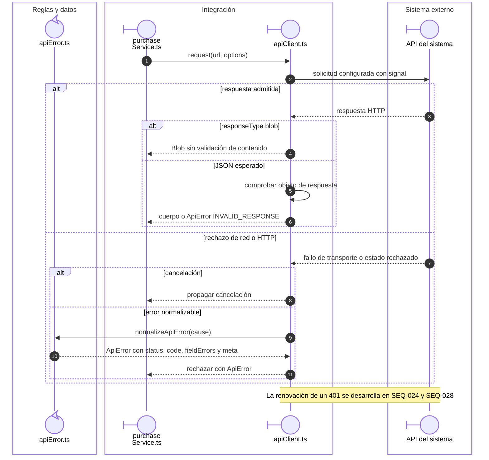
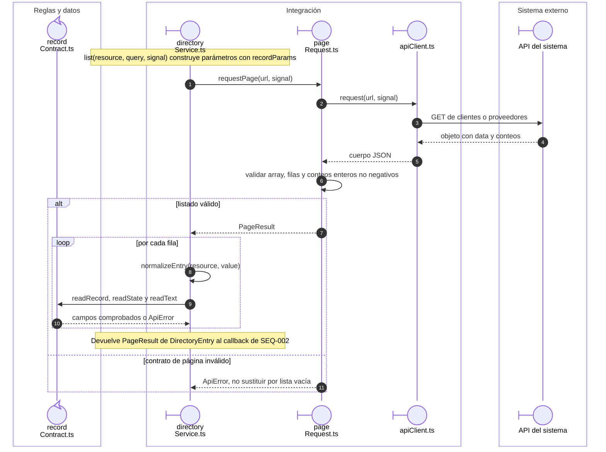

# Transporte y contratos compartidos

El cliente HTTP del sistema encapsula la biblioteca de transporte. Las figuras muestran
archivos propios; la tecnología utilizada se identifica en la guía de roles.

## Respuesta JSON y traducción de errores

**Identificador:** `DIA-VUE-SEQ-034`. **Pregunta:** ¿Qué comprueba el cliente antes de devolver una respuesta al servicio?

**Lectura visual:** [roles y callbacks](../00-reading-and-roles.md).

## Lectura paginada y adaptación de filas

**Identificador:** `DIA-VUE-SEQ-035`. **Pregunta:** ¿Quién comprueba los conteos y quién convierte cada registro de Directorio?

**Lectura visual:** [roles y callbacks](../00-reading-and-roles.md).

## Aplicaciones del contrato paginado

`pageRequest.ts` comprueba la estructura de página. Cada servicio transforma sus
filas con el contrato del recurso; compartir paginación no vuelve intercambiables
los registros del negocio.

| Servicio | Propietario de la adaptación de filas |
| --- | --- |
| `catalogService.list` | `normalizeEntry` en `catalogService.ts`. |
| `directoryService.list` | `normalizeEntry` en `directoryService.ts`, con lectores de `recordContract.ts`. |
| `identityService.list` | `normalizeEntry` y `readAccesses` en `identityService.ts`. |
| `inventoryService.list` | `normalizeInventoryRow` en `inventoryMapper.ts`. |
| `purchaseService.list` | `normalizePurchaseRow` en `purchaseResponseMapper.ts`. |
| `issueService.list` | `normalizeIssueRow` en `issueResponseMapper.ts`. |
| `movementService.list` | Normalización del historial en `movementService.ts`. |

## Fuentes de los participantes

[purchaseService.ts](../../../../../src/modules/purchases/services/purchaseService.ts),
[apiClient.ts](../../../../../src/shared/http/apiClient.ts),
[apiError.ts](../../../../../src/shared/http/apiError.ts),
[directoryService.ts](../../../../../src/modules/directory/services/directoryService.ts),
[pageRequest.ts](../../../../../src/shared/http/pageRequest.ts),
[recordContract.ts](../../../../../src/shared/http/recordContract.ts).
