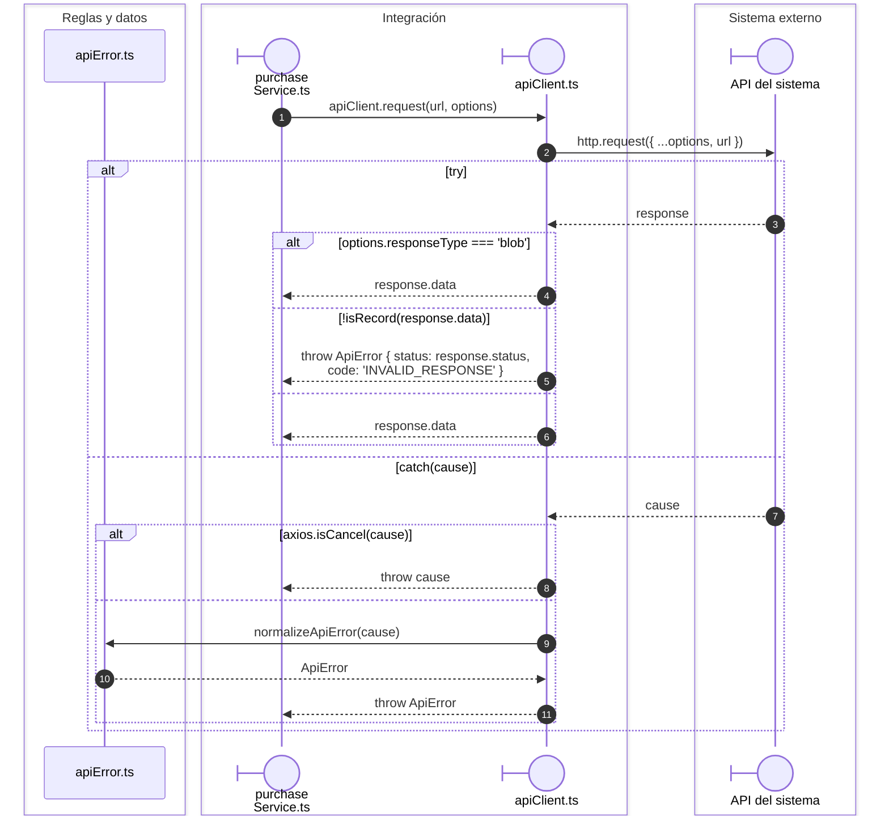
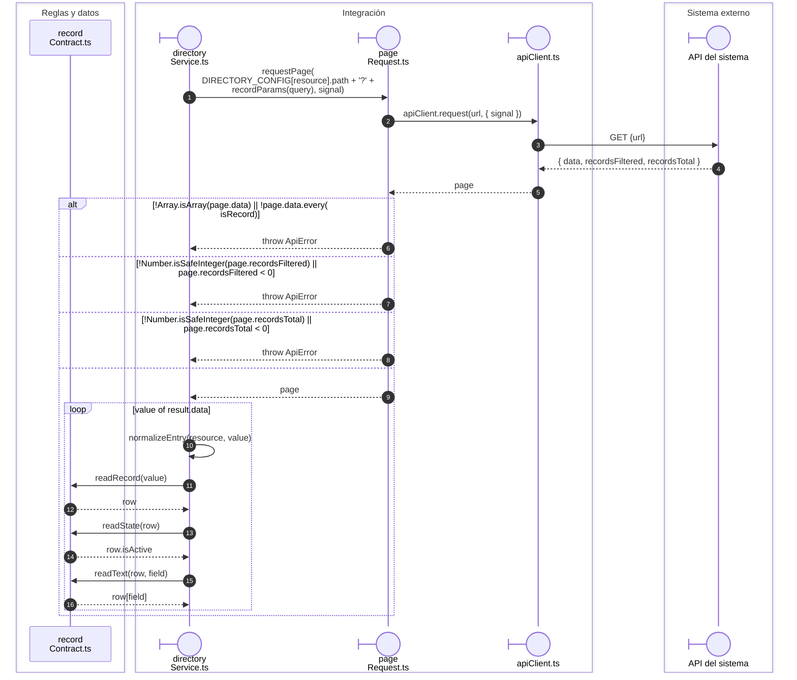

# Transporte y contratos compartidos

## Respuesta JSON y traducción de errores

**Identificador:** `DIA-VUE-SEQ-034`.

## Lectura paginada y adaptación de filas

**Identificador:** `DIA-VUE-SEQ-035`.

## Fuentes de los participantes

[purchaseService.ts](../../../../../src/modules/purchases/services/purchaseService.ts),
[apiClient.ts](../../../../../src/shared/http/apiClient.ts),
[apiError.ts](../../../../../src/shared/http/apiError.ts),
[directoryService.ts](../../../../../src/modules/directory/services/directoryService.ts),
[pageRequest.ts](../../../../../src/shared/http/pageRequest.ts),
[recordContract.ts](../../../../../src/shared/http/recordContract.ts).

## Secuencias relacionadas

[DIA-VUE-SEQ-024](../01-session/04-concurrent-renewal.md#escenario-y-contratos), [DIA-VUE-SEQ-028](../01-session/04-concurrent-renewal.md#continuación-de-cada-petición-original), [DIA-VUE-SEQ-002](01-list-and-record-save.md#consulta-remota).
