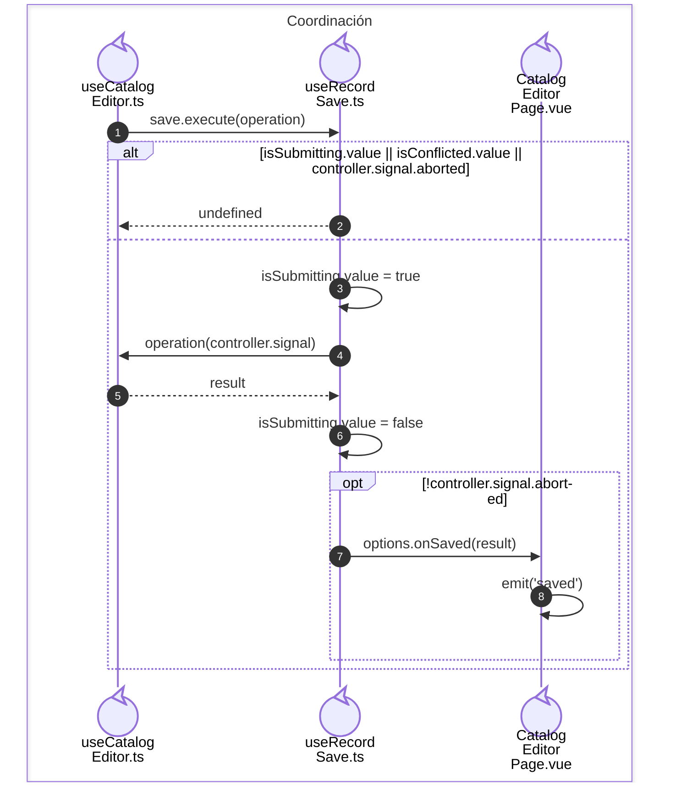
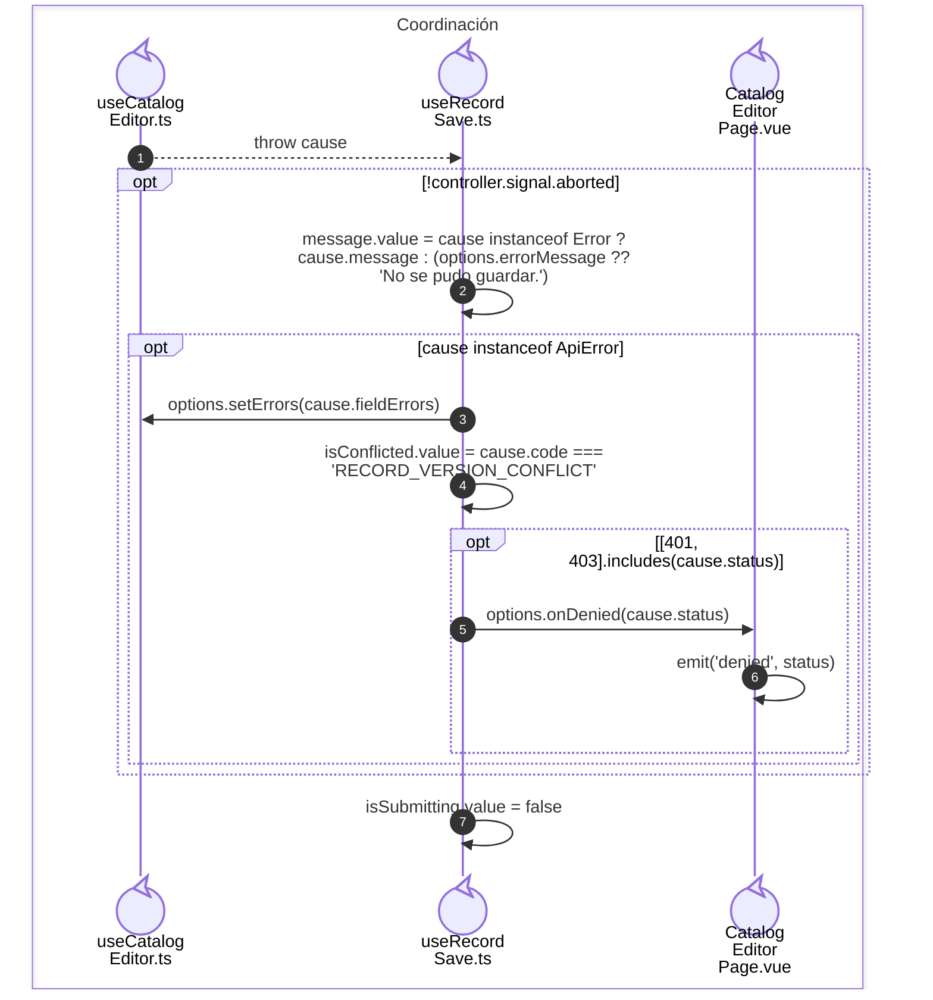

# execute(operation)

**Identificador:** `DIA-VUE-SEQ-051`.

## catch(cause)

**Identificador:** `DIA-VUE-SEQ-053`.

## Fuentes de los participantes

[useCatalogEditor.ts](../../../../../src/modules/catalogs/composables/useCatalogEditor.ts),
[useRecordSave.ts](../../../../../src/shared/composables/useRecordSave.ts),
[CatalogEditorPage.vue](../../../../../src/modules/catalogs/pages/CatalogEditorPage.vue).
