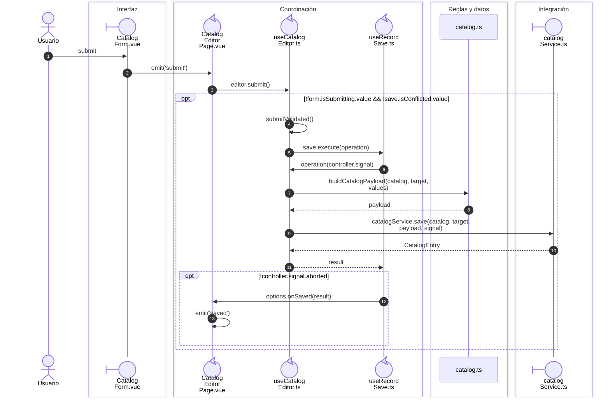
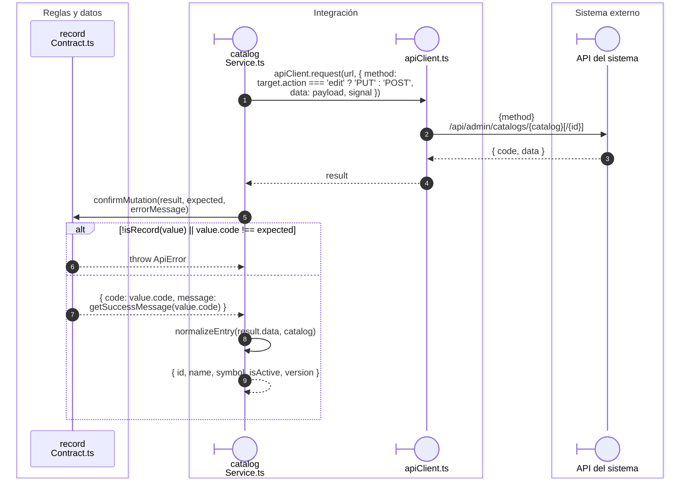

# Alta y edición de catálogos

**Casos relacionados:** CU-CAT-10/11/13/14/16/17/19/20/22/23/25/26; soporte de Directorio.

## Secuencia aplicada

**Identificador:** `DIA-VUE-SEQ-004`.

## Transporte y registro confirmado

**Identificador:** `DIA-VUE-SEQ-036`.

## Fuentes de los participantes

[CatalogForm.vue](../../../../../src/modules/catalogs/components/CatalogForm.vue),
[CatalogEditorPage.vue](../../../../../src/modules/catalogs/pages/CatalogEditorPage.vue),
[useCatalogEditor.ts](../../../../../src/modules/catalogs/composables/useCatalogEditor.ts),
[useRecordSave.ts](../../../../../src/shared/composables/useRecordSave.ts),
[catalog.ts](../../../../../src/modules/catalogs/catalog.ts),
[catalogService.ts](../../../../../src/modules/catalogs/services/catalogService.ts),
[recordContract.ts](../../../../../src/shared/http/recordContract.ts),
[apiClient.ts](../../../../../src/shared/http/apiClient.ts).

## Secuencias relacionadas

[DIA-VUE-SEQ-051](../02-shared-runtime/08-record-save.md).
