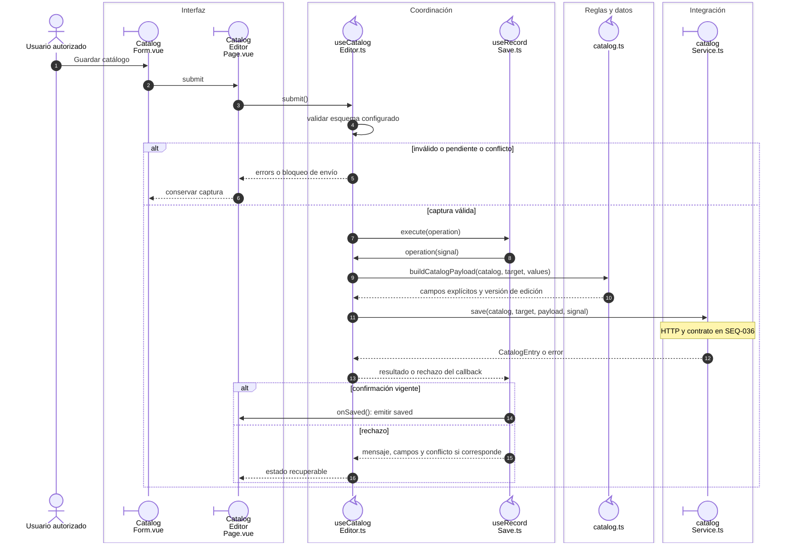
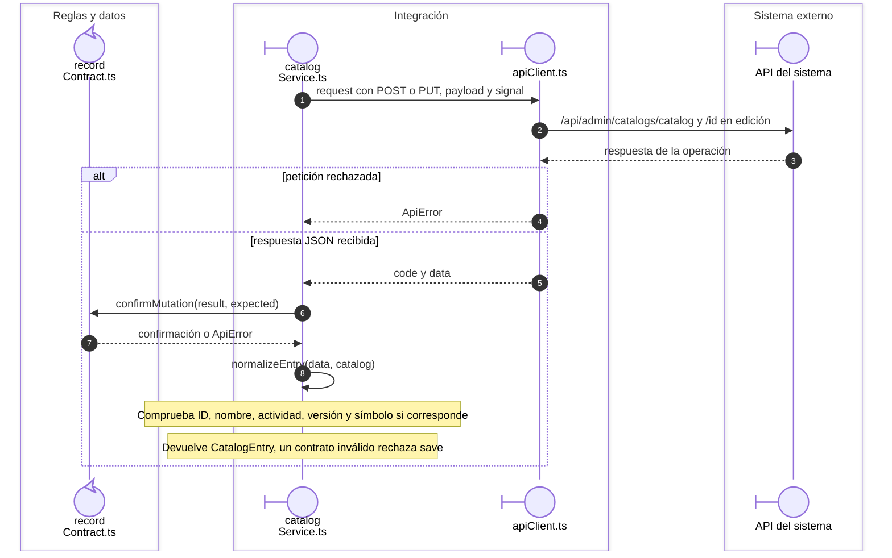

# Alta y edición de catálogos

## Escenario y contratos

**Casos relacionados:** CU-CAT-10/11/13/14/16/17/19/20/22/23/25/26; soporte de Directorio.

## Secuencia aplicada

**Identificador:** `DIA-VUE-SEQ-004`.

**Lectura visual:** [líneas de vida, números y mensajes](../../diagram-reading.md#secuencias).

La secuencia desarrolla el camino confirmado después de validar la captura. El callback
pertenece al editor; `useRecordSave` controla su ejecución. `catalogService` comprueba
el código y normaliza `CatalogEntry`; el callback de página no necesita consumir la fila.

| Condición | Resultado |
| --- | --- |
| Precarga | Esquema por catálogo y valores iniciales sin publicar errores. |
| Captura inválida | `handleSubmit` presenta campos y no ejecuta `execute`. |
| Rechazo o conflicto | El error vuelve desde el servicio al callback y al guardado compartido; conserva captura y bloquea el reenvío incompatible cuando corresponde. |
| Confirmación tardía | Si la señal está abortada, no llama al contenedor. |

## Transporte y registro confirmado

**Identificador:** `DIA-VUE-SEQ-036`. **Pregunta:** ¿Qué valida el servicio antes de entregar CatalogEntry?

## Reglas y recuperación

Los seis catálogos comparten coordinación y conservan campos/límites de su definición. El símbolo sólo aplica a Unidades. Directorio usa su propio editor/servicio y payload, con el mismo ciclo de guardado, sin convertir los dominios en un CRUD universal.

## Evidencia

catalogEditorTest.ts, catalogs.spec.ts y directoryTest.ts. La [matriz por caso](../../../../testing/04-use-case-coverage.md) identifica alcance y límites, y el [registro CP](../../../../testing/03-test-cases.md) concreta datos y oráculos críticos.

## Fuentes de los participantes

[CatalogForm.vue](../../../../../src/modules/catalogs/components/CatalogForm.vue),
[CatalogEditorPage.vue](../../../../../src/modules/catalogs/pages/CatalogEditorPage.vue),
[useCatalogEditor.ts](../../../../../src/modules/catalogs/composables/useCatalogEditor.ts),
[useRecordSave.ts](../../../../../src/shared/composables/useRecordSave.ts),
[catalog.ts](../../../../../src/modules/catalogs/catalog.ts),
[catalogService.ts](../../../../../src/modules/catalogs/services/catalogService.ts),
[recordContract.ts](../../../../../src/shared/http/recordContract.ts),
[apiClient.ts](../../../../../src/shared/http/apiClient.ts).
