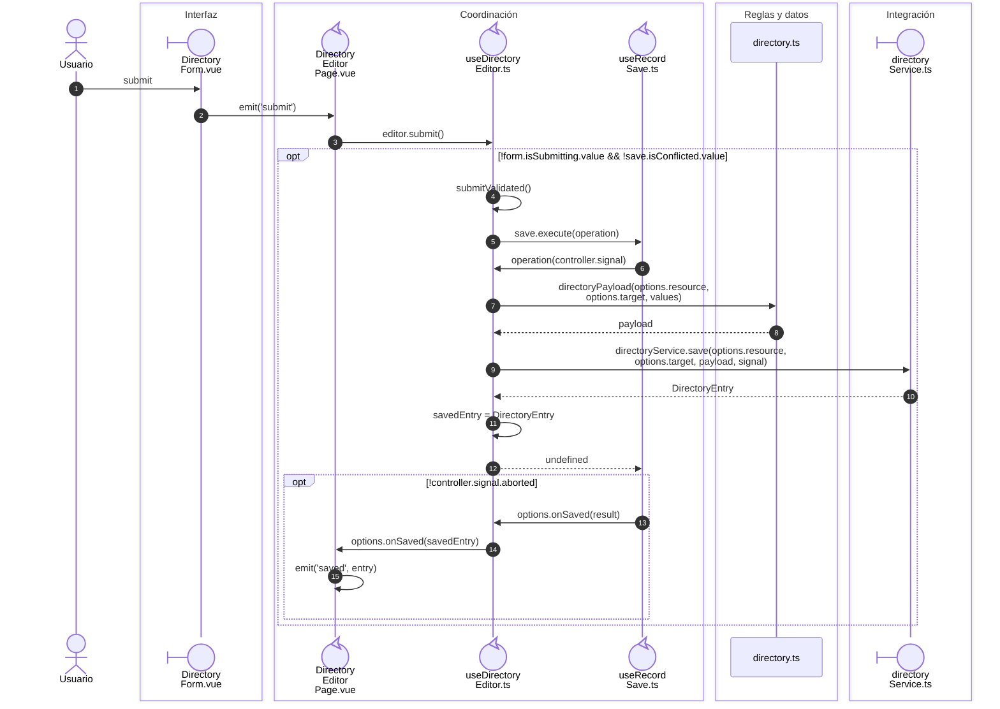
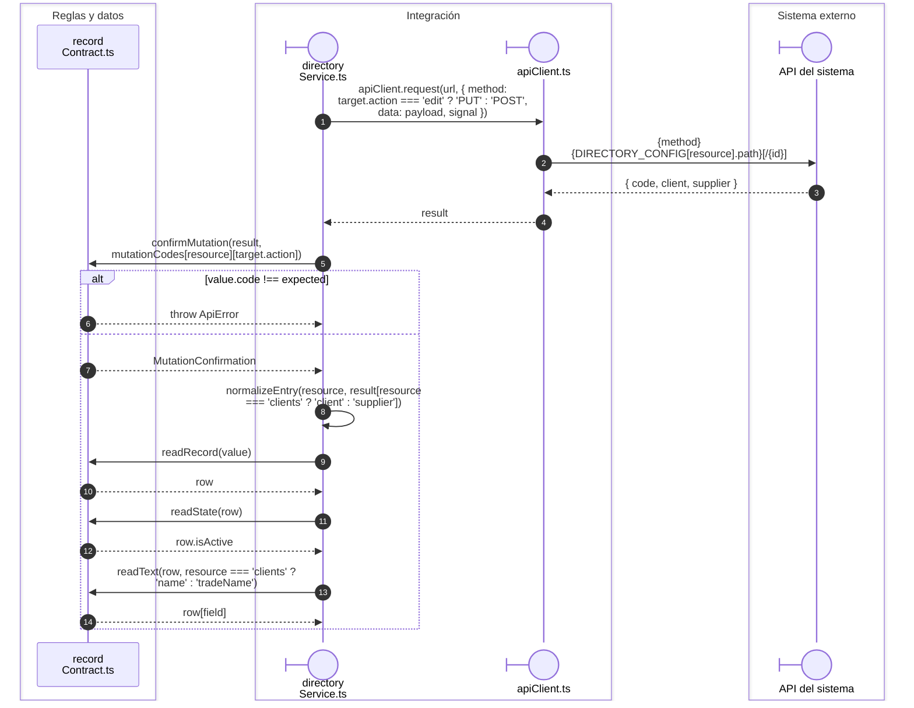

# Directorio: alta, edición y retorno de opción

## Secuencia aplicada

**Identificador:** `DIA-VUE-SEQ-022`.

## Transporte y retorno del registro

**Identificador:** `DIA-VUE-SEQ-037`.

## Fuentes de los participantes

[DirectoryForm.vue](../../../../../src/modules/directory/components/DirectoryForm.vue),
[DirectoryEditorPage.vue](../../../../../src/modules/directory/pages/DirectoryEditorPage.vue),
[useDirectoryEditor.ts](../../../../../src/modules/directory/composables/useDirectoryEditor.ts),
[useRecordSave.ts](../../../../../src/shared/composables/useRecordSave.ts),
[directory.ts](../../../../../src/modules/directory/directory.ts),
[directoryService.ts](../../../../../src/modules/directory/services/directoryService.ts),
[recordContract.ts](../../../../../src/shared/http/recordContract.ts),
[apiClient.ts](../../../../../src/shared/http/apiClient.ts).

## Secuencias relacionadas

[DIA-VUE-SEQ-051](../02-shared-runtime/08-record-save.md).
