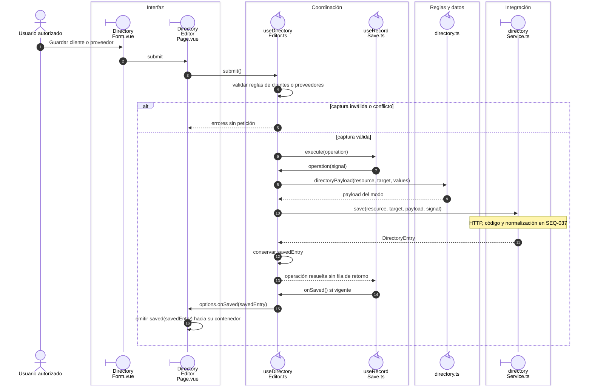
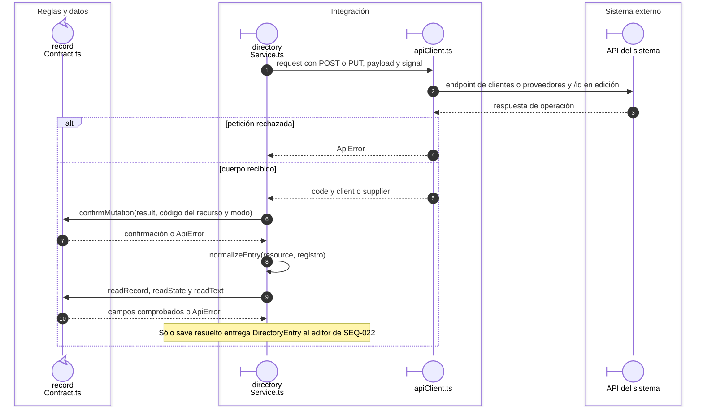

# Directorio: alta, edición y retorno de opción

## Escenario y fuente

CU-CAT-02/03/06/07. Fuentes: `useDirectoryEditor`, `directoryPayload`,
`directoryService.save` y `DirectoryCreationPage`. Clientes/Proveedores conservan
campos y permisos propios; la confirmación puede cerrar una página o devolver una opción.

## Secuencia aplicada

**Identificador:** `DIA-VUE-SEQ-022`. Mensajes numerados y ramas de modo/respuesta.

**Lectura visual:** [líneas de vida, números y mensajes](../../diagram-reading.md#secuencias).

La figura parte de una captura válida. `directoryPayload` se construye en el callback
del editor; éste conserva la entrada devuelta en `savedEntry`. La operación termina
sin devolver esa fila a `useRecordSave`; su callback de éxito notifica a la página con
la entrada conservada. Un error propaga al guardado compartido y mantiene captura/
conflicto. Validar, abrir o cancelar no dispara una escritura.

La selección del origen sólo acepta el registro confirmado y activo conforme al
consumidor. Abrir/cancelar el auxiliar no guarda el formulario principal. Las
[secuencias de alta contextual](../../development/design-and-construction-patterns/09-contextual-creation.md)
identifican cada Workspace y callback. Evidencia: `directoryTest.ts`, `records.spec.ts`
y `selectCreation.spec.ts`.

## Transporte y retorno del registro

**Identificador:** `DIA-VUE-SEQ-037`. **Pregunta:** ¿Cómo se obtiene una opción de cliente o proveedor confirmada?

## Fuentes de los participantes

[DirectoryForm.vue](../../../../../src/modules/directory/components/DirectoryForm.vue),
[DirectoryEditorPage.vue](../../../../../src/modules/directory/pages/DirectoryEditorPage.vue),
[useDirectoryEditor.ts](../../../../../src/modules/directory/composables/useDirectoryEditor.ts),
[useRecordSave.ts](../../../../../src/shared/composables/useRecordSave.ts),
[directory.ts](../../../../../src/modules/directory/directory.ts),
[directoryService.ts](../../../../../src/modules/directory/services/directoryService.ts),
[recordContract.ts](../../../../../src/shared/http/recordContract.ts),
[apiClient.ts](../../../../../src/shared/http/apiClient.ts).
