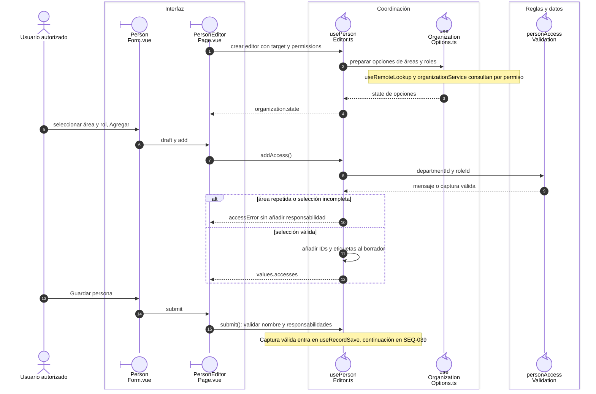

# Personas y responsabilidades

## Escenario y contratos

**Casos relacionados:** CU-IDA-02/03.

## Secuencia aplicada

**Identificador:** `DIA-VUE-SEQ-005`.

**Lectura visual:** [líneas de vida, números y mensajes](../../diagram-reading.md#secuencias).

El [guardado de persona](04-person-save.md) completa validación, payload, servicio y
confirmación.

## Reglas y recuperación

Las responsabilidades son de la persona; no se envían etiquetas ni datos de cuenta. Quitar la última responsabilidad impide guardar. Las asignaciones de cuenta tienen una secuencia independiente.

## Evidencia

identityTest.ts y records.spec.ts. La [matriz por caso](../../../../testing/04-use-case-coverage.md) identifica alcance y límites, y el [registro CP](../../../../testing/03-test-cases.md) concreta datos y oráculos críticos.

## Fuentes de los participantes

[PersonForm.vue](../../../../../src/modules/identity/components/PersonForm.vue),
[PersonEditorPage.vue](../../../../../src/modules/identity/pages/PersonEditorPage.vue),
[usePersonEditor.ts](../../../../../src/modules/identity/composables/usePersonEditor.ts),
[useOrganizationOptions.ts](../../../../../src/shared/composables/useOrganizationOptions.ts),
[personAccessValidation](../../../../../../back/src/public/js/utils/validations/validators.js).
