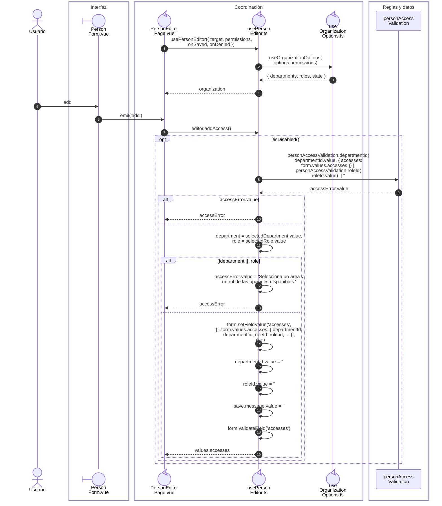

# Personas y responsabilidades

**Casos relacionados:** CU-IDA-02/03.

## Secuencia aplicada

**Identificador:** `DIA-VUE-SEQ-005`.

## Fuentes de los participantes

[PersonForm.vue](../../../../../src/modules/identity/components/PersonForm.vue),
[PersonEditorPage.vue](../../../../../src/modules/identity/pages/PersonEditorPage.vue),
[usePersonEditor.ts](../../../../../src/modules/identity/composables/usePersonEditor.ts),
[useOrganizationOptions.ts](../../../../../src/shared/composables/useOrganizationOptions.ts),
[personAccessValidation](../../../../../../back/src/public/js/utils/validations/validators.js).

## Secuencias relacionadas

[DIA-VUE-SEQ-039](04-person-save.md#coordinación-del-guardado).
