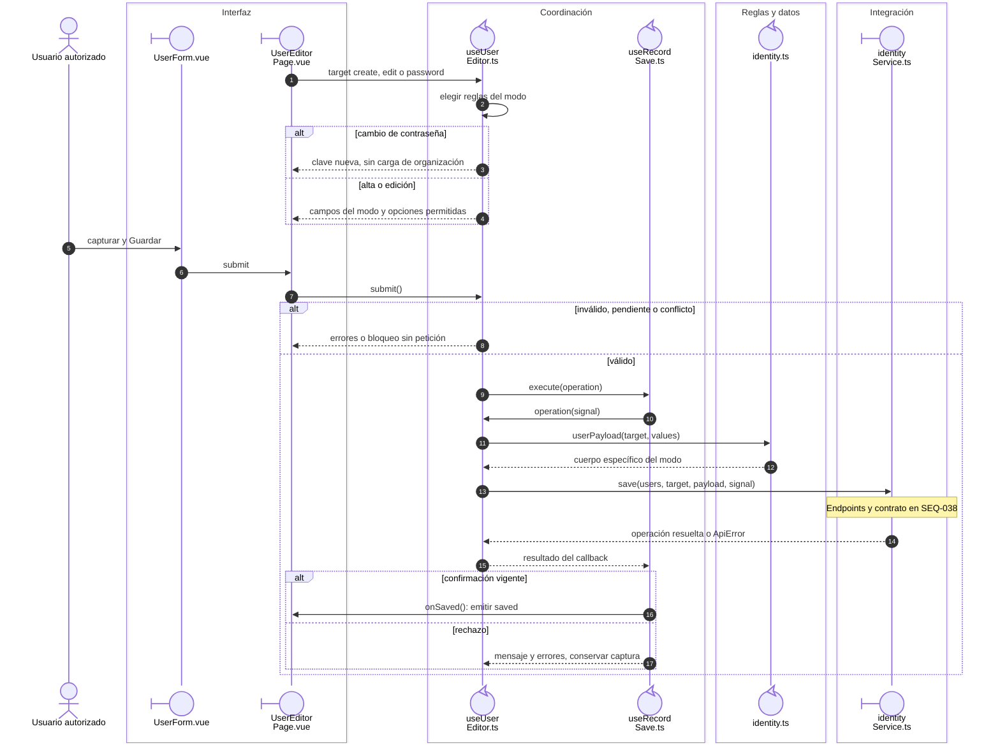

# Cuenta, edición y contraseña

## Escenario y contratos

**Casos relacionados:** CU-IDA-06/07/08.

## Secuencia aplicada

**Identificador:** `DIA-VUE-SEQ-006`.

**Lectura visual:** [líneas de vida, números y mensajes](../../diagram-reading.md#secuencias).

## Reglas y recuperación

Edición no vuelve a enviar personId/contraseña. Password sólo envía clave y expectedVersion. La autorización y el almacenamiento seguro de credenciales pertenecen a la API.

## Evidencia

identityTest.ts y records.spec.ts. La [matriz por caso](../../../../testing/04-use-case-coverage.md) identifica alcance y límites, y el [registro CP](../../../../testing/03-test-cases.md) concreta datos y oráculos críticos.

## Fuentes de los participantes

[UserForm.vue](../../../../../src/modules/identity/components/UserForm.vue),
[UserEditorPage.vue](../../../../../src/modules/identity/pages/UserEditorPage.vue),
[useUserEditor.ts](../../../../../src/modules/identity/composables/useUserEditor.ts),
[useRecordSave.ts](../../../../../src/shared/composables/useRecordSave.ts),
[identity.ts](../../../../../src/modules/identity/identity.ts),
[identityService.ts](../../../../../src/modules/identity/services/identityService.ts).
