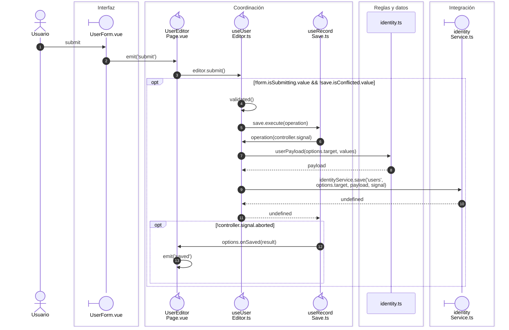

# Cuenta, edición y contraseña

**Casos relacionados:** CU-IDA-06/07/08.

## Secuencia aplicada

**Identificador:** `DIA-VUE-SEQ-006`.

## Fuentes de los participantes

[UserForm.vue](../../../../../src/modules/identity/components/UserForm.vue),
[UserEditorPage.vue](../../../../../src/modules/identity/pages/UserEditorPage.vue),
[useUserEditor.ts](../../../../../src/modules/identity/composables/useUserEditor.ts),
[useRecordSave.ts](../../../../../src/shared/composables/useRecordSave.ts),
[identity.ts](../../../../../src/modules/identity/identity.ts),
[identityService.ts](../../../../../src/modules/identity/services/identityService.ts).

## Secuencias relacionadas

[DIA-VUE-SEQ-038](03-save-transport.md#petición-y-confirmación-de-identidad), [DIA-VUE-SEQ-051](../02-shared-runtime/08-record-save.md).
