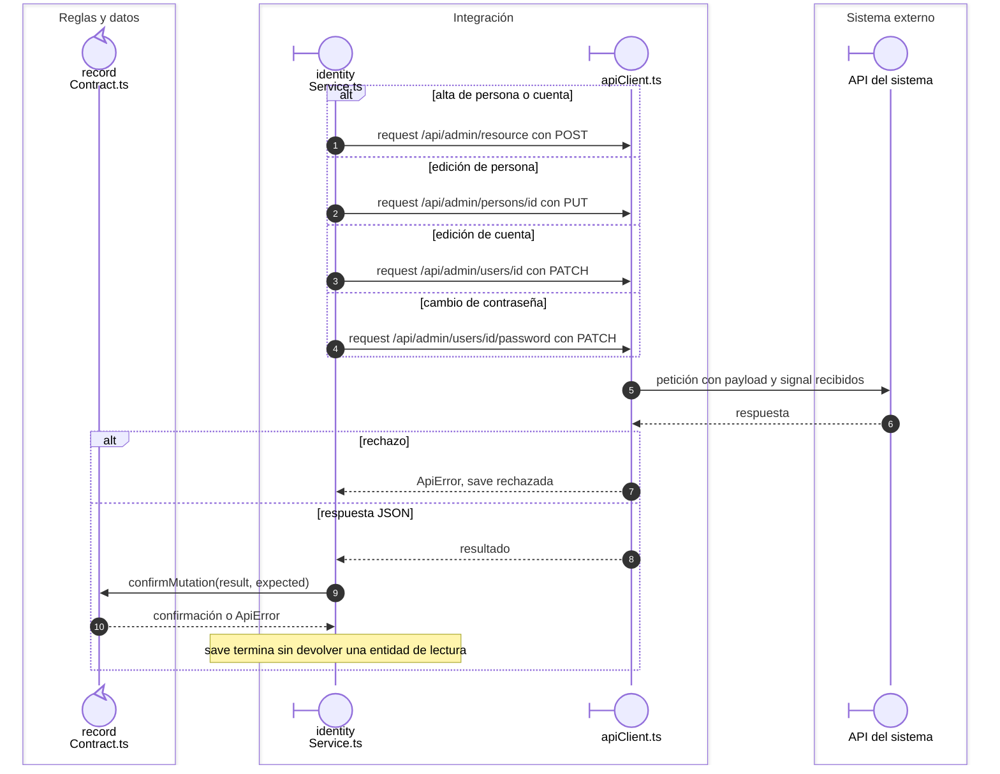

# Identidad: transporte de persona, cuenta y contraseña

Continúa las operaciones de `usePersonEditor` y `useUserEditor`. La selección del
payload ocurre en `identity.ts`; el servicio decide el endpoint y el código esperado.

## Petición y confirmación de identidad

**Identificador:** `DIA-VUE-SEQ-038`. **Pregunta:** ¿Qué cambia en HTTP al crear persona, editar cuenta o cambiar contraseña?

**Lectura visual:** [roles y callbacks](../00-reading-and-roles.md).

## Fuentes de los participantes

[identityService.ts](../../../../../src/modules/identity/services/identityService.ts),
[recordContract.ts](../../../../../src/shared/http/recordContract.ts),
[apiClient.ts](../../../../../src/shared/http/apiClient.ts).
