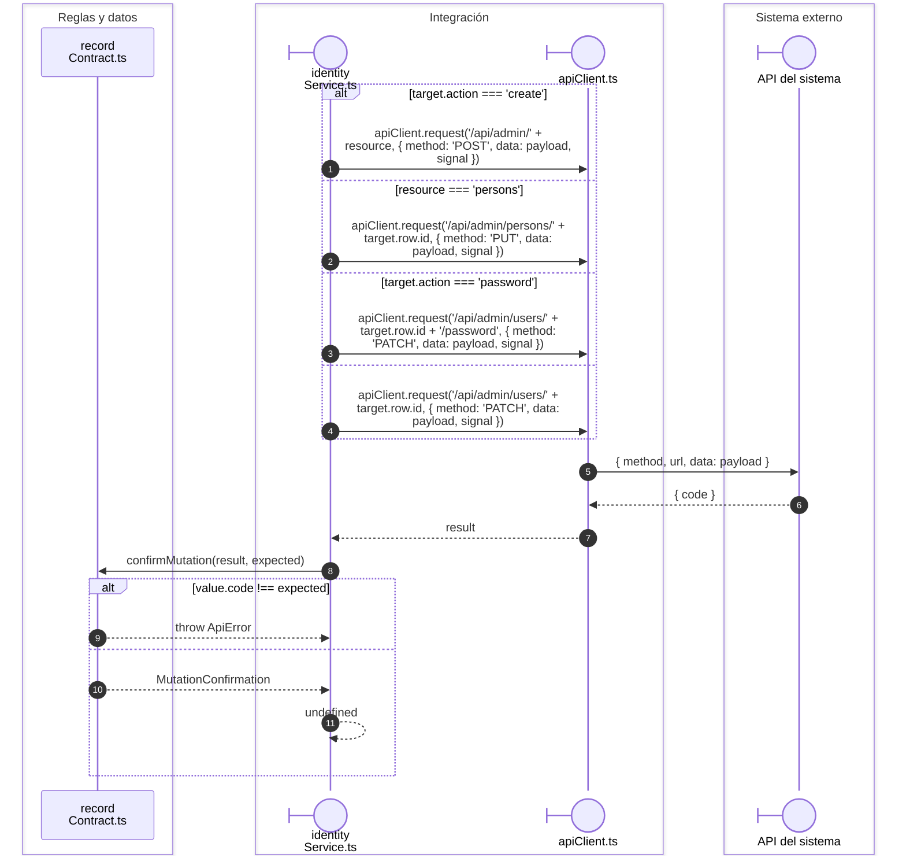

# Identidad: transporte de persona, cuenta y contraseña

## Petición y confirmación de identidad

**Identificador:** `DIA-VUE-SEQ-038`.

## Fuentes de los participantes

[identityService.ts](../../../../../src/modules/identity/services/identityService.ts),
[recordContract.ts](../../../../../src/shared/http/recordContract.ts),
[apiClient.ts](../../../../../src/shared/http/apiClient.ts).
