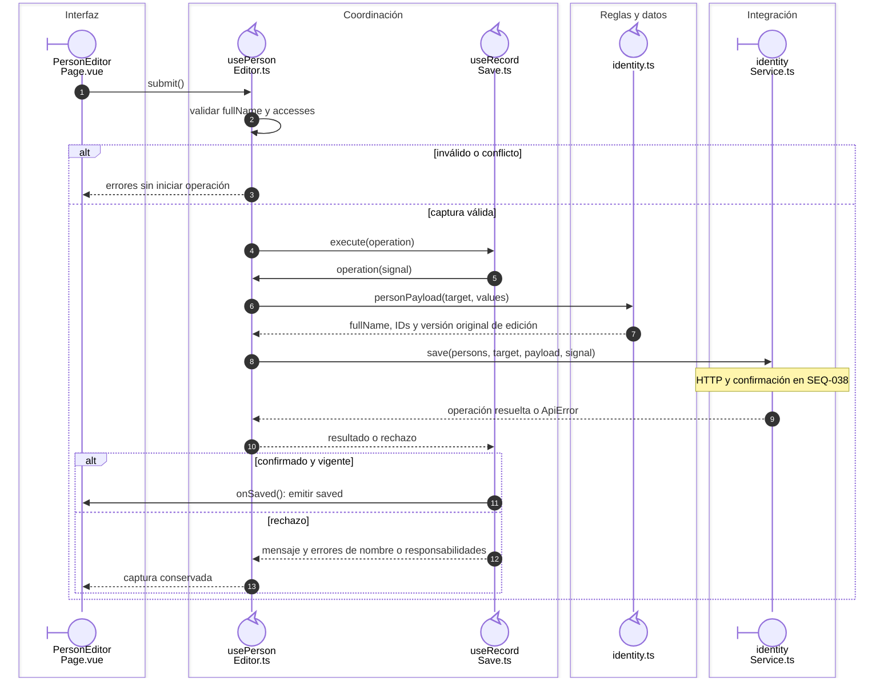

# Persona: guardado del nombre y las responsabilidades

El borrador de responsabilidades procede de `SEQ-005`. El payload elimina etiquetas
y conserva únicamente los identificadores que admite la escritura.

## Coordinación del guardado

**Identificador:** `DIA-VUE-SEQ-039`. **Pregunta:** ¿Quién transforma el borrador y entrega la confirmación al contenedor?

**Lectura visual:** [roles y callbacks](../00-reading-and-roles.md).

## Fuentes de los participantes

[PersonEditorPage.vue](../../../../../src/modules/identity/pages/PersonEditorPage.vue),
[usePersonEditor.ts](../../../../../src/modules/identity/composables/usePersonEditor.ts),
[useRecordSave.ts](../../../../../src/shared/composables/useRecordSave.ts),
[identity.ts](../../../../../src/modules/identity/identity.ts),
[identityService.ts](../../../../../src/modules/identity/services/identityService.ts).
