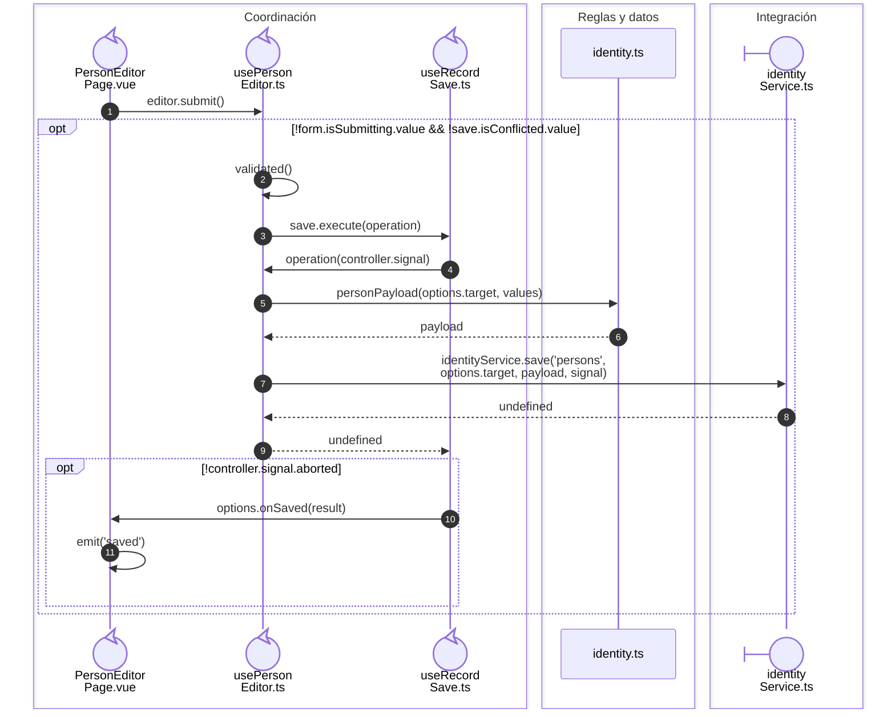

# Persona: guardado del nombre y las responsabilidades

## Coordinación del guardado

**Identificador:** `DIA-VUE-SEQ-039`.

## Fuentes de los participantes

[PersonEditorPage.vue](../../../../../src/modules/identity/pages/PersonEditorPage.vue),
[usePersonEditor.ts](../../../../../src/modules/identity/composables/usePersonEditor.ts),
[useRecordSave.ts](../../../../../src/shared/composables/useRecordSave.ts),
[identity.ts](../../../../../src/modules/identity/identity.ts),
[identityService.ts](../../../../../src/modules/identity/services/identityService.ts).

## Secuencias relacionadas

[DIA-VUE-SEQ-005](01-person-responsibilities.md#secuencia-aplicada), [DIA-VUE-SEQ-038](03-save-transport.md#petición-y-confirmación-de-identidad), [DIA-VUE-SEQ-051](../02-shared-runtime/08-record-save.md).
