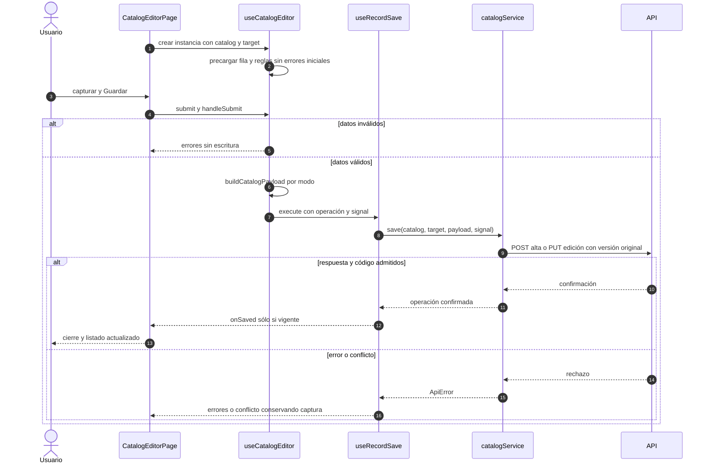

# Alta y edición de catálogos

## Escenario y contratos

**Casos relacionados:** CU-CAT-10/11/13/14/16/17/19/20/22/23/25/26; soporte de Directorio.

**Fuente técnica:** useCatalogEditor.ts, catalog.ts, useRecordSave.ts y catalogService.ts. El diagrama describe el código Vue y sus fronteras. La API es un participante externo; sus transacciones internas no se atribuyen al navegador.

## Secuencia aplicada

**Identificador:** `DIA-VUE-SEQ-004`. Mensajes numerados; líneas continuas = invocación/solicitud, discontinuas = respuesta o resultado. Las ramas representan decisiones reales; no son ejecuciones simultáneas.

## Reglas y recuperación

Los seis catálogos comparten coordinación y conservan campos/límites de su definición. El símbolo sólo aplica a Unidades. Directorio usa su propio editor/servicio y payload, con el mismo ciclo de guardado, sin convertir los dominios en un CRUD universal.

## Evidencia

catalogEditorTest.ts, catalogs.spec.ts y directoryTest.ts. La [matriz por caso](../../../testing/04-use-case-coverage.md) identifica alcance y límites, y el [registro CP](../../../testing/03-test-cases.md) concreta datos y oráculos críticos.
