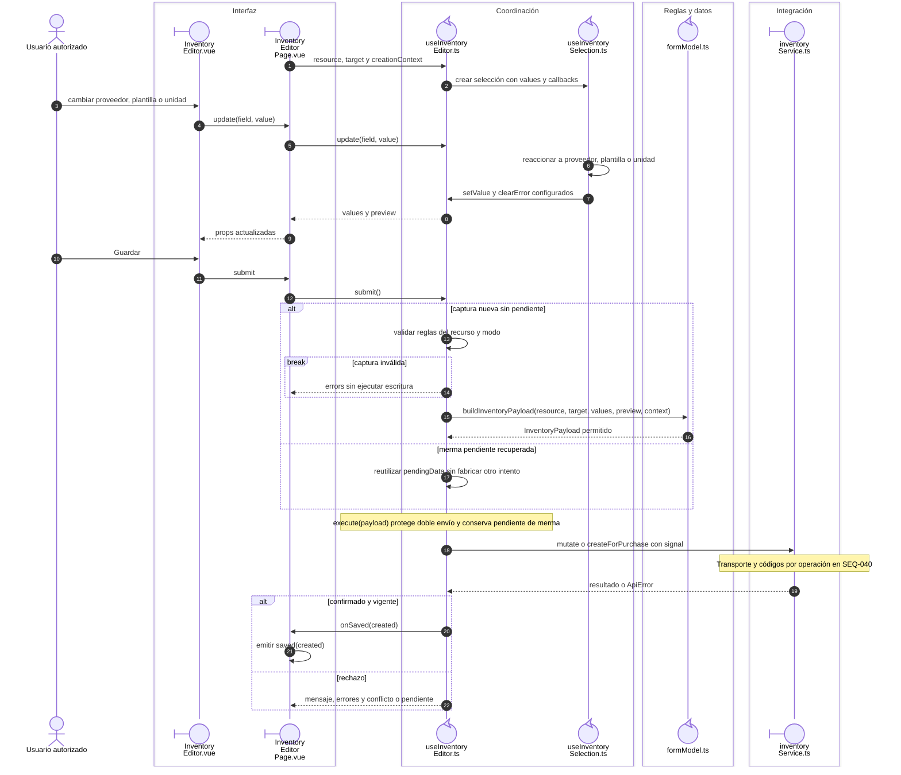

# Selección dependiente y escritura de inventario

## Escenario y contratos

**Casos relacionados:** CU-ALM-02/03/05/10/11/12/13/18/19/21.

## Secuencia aplicada

**Identificador:** `DIA-VUE-SEQ-007`.

**Lectura visual:** [líneas de vida, números y mensajes](../../diagram-reading.md#secuencias).

## Reglas y recuperación

El recurso fija reglas; Consumibles omite medidas, edición preserva identidad/stock y el ajuste conserva versión/motivo. La recuperación de merma se detalla en las siguientes secuencias y no se resuelve como un reintento genérico.

## Evidencia

inventoryFormTest.ts, inventoryListTest.ts y warehouse.spec.ts. La [matriz por caso](../../../../testing/04-use-case-coverage.md) identifica alcance y límites, y el [registro CP](../../../../testing/03-test-cases.md) concreta datos y oráculos críticos.

## Fuentes de los participantes

[InventoryEditor.vue](../../../../../src/modules/warehouse/components/InventoryEditor.vue),
[InventoryEditorPage.vue](../../../../../src/modules/warehouse/pages/InventoryEditorPage.vue),
[useInventoryEditor.ts](../../../../../src/modules/warehouse/composables/useInventoryEditor.ts),
[useInventorySelection.ts](../../../../../src/modules/warehouse/composables/useInventorySelection.ts),
[formModel.ts](../../../../../src/modules/warehouse/formModel.ts),
[inventoryService.ts](../../../../../src/modules/warehouse/services/inventoryService.ts).
