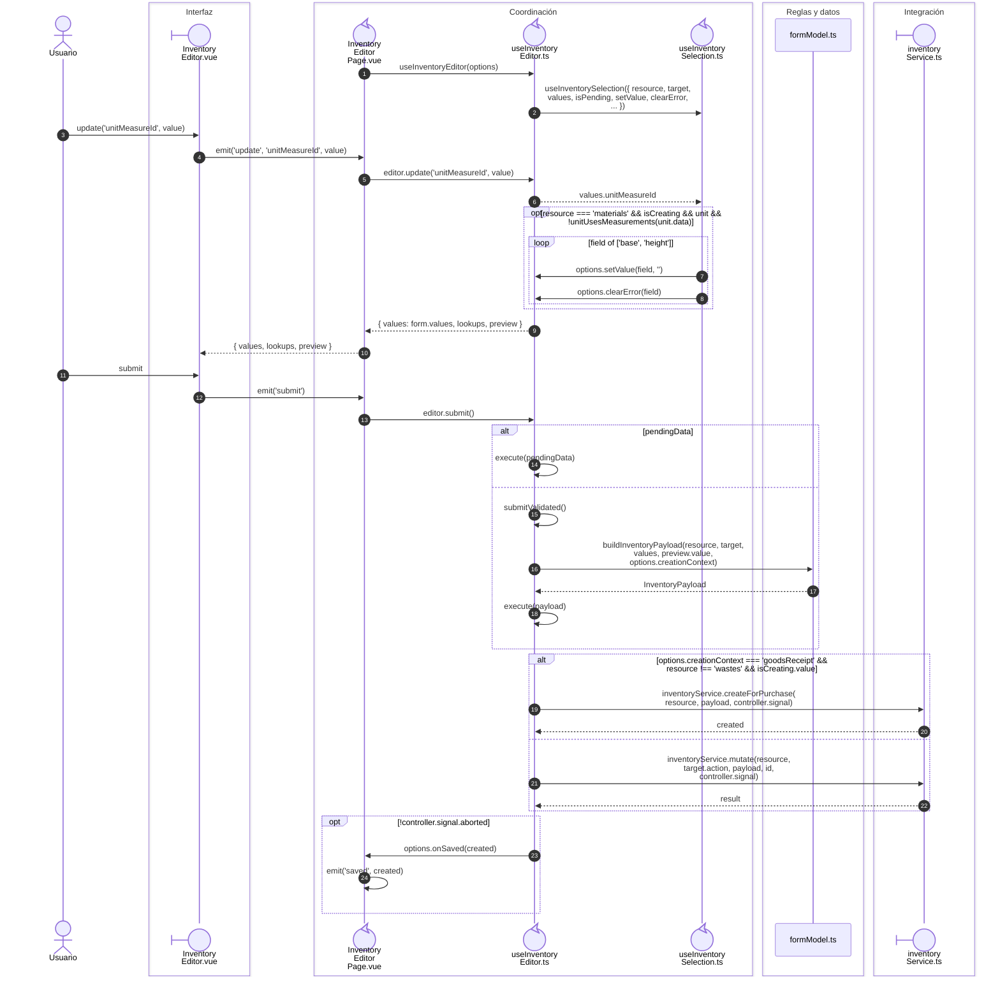

# Selección dependiente y escritura de inventario

**Casos relacionados:** CU-ALM-02/03/05/10/11/12/13/18/19/21.

## Secuencia aplicada

**Identificador:** `DIA-VUE-SEQ-007`.

## Fuentes de los participantes

[InventoryEditor.vue](../../../../../src/modules/warehouse/components/InventoryEditor.vue),
[InventoryEditorPage.vue](../../../../../src/modules/warehouse/pages/InventoryEditorPage.vue),
[useInventoryEditor.ts](../../../../../src/modules/warehouse/composables/useInventoryEditor.ts),
[useInventorySelection.ts](../../../../../src/modules/warehouse/composables/useInventorySelection.ts),
[formModel.ts](../../../../../src/modules/warehouse/formModel.ts),
[inventoryService.ts](../../../../../src/modules/warehouse/services/inventoryService.ts).

## Secuencias relacionadas

[DIA-VUE-SEQ-040](06-inventory-transport.md#operación-y-código-del-recurso).
