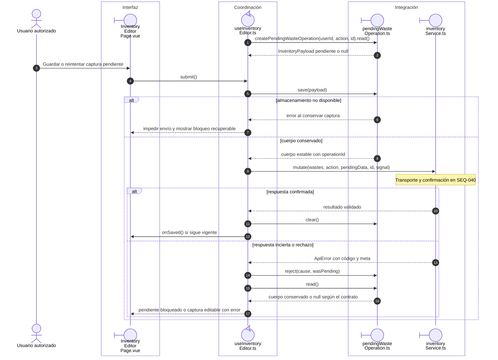

# Merma: respuesta incierta y reintento

## Escenario y contratos

**Casos relacionados:** CU-ALM-10/13; RF-VUE-007/008.

## Secuencia aplicada

**Identificador:** `DIA-VUE-SEQ-008`.

**Lectura visual:** [líneas de vida, números y mensajes](../../diagram-reading.md#secuencias).

## Reglas y recuperación

Reabrir recupera el cuerpo y no convierte una captura modificada en otro intento con la misma clave. Abortar en navegador no revierte una operación ya confirmada en servidor. El [diagrama de estados](../../logical/document-states.md) complementa el orden temporal.

## Evidencia

inventoryFormTest.ts, warehouse.spec.ts y CP-VUE-WH-011-01/02. La [matriz por caso](../../../../testing/04-use-case-coverage.md) identifica alcance y límites, y el [registro CP](../../../../testing/03-test-cases.md) concreta datos y oráculos críticos.

## Fuentes de los participantes

[InventoryEditorPage.vue](../../../../../src/modules/warehouse/pages/InventoryEditorPage.vue),
[useInventoryEditor.ts](../../../../../src/modules/warehouse/composables/useInventoryEditor.ts),
[pendingWasteOperation.ts](../../../../../src/modules/warehouse/services/pendingWasteOperation.ts),
[inventoryService.ts](../../../../../src/modules/warehouse/services/inventoryService.ts).
