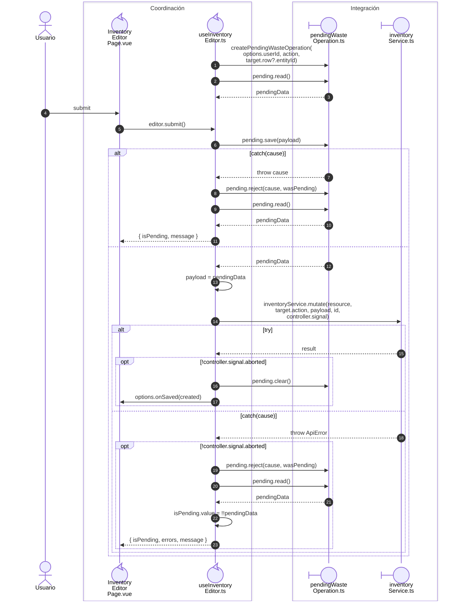

# Merma: respuesta incierta y reintento

**Casos relacionados:** CU-ALM-10/13; RF-VUE-007/008.

## Secuencia aplicada

**Identificador:** `DIA-VUE-SEQ-008`.

## Fuentes de los participantes

[InventoryEditorPage.vue](../../../../../src/modules/warehouse/pages/InventoryEditorPage.vue),
[useInventoryEditor.ts](../../../../../src/modules/warehouse/composables/useInventoryEditor.ts),
[pendingWasteOperation.ts](../../../../../src/modules/warehouse/services/pendingWasteOperation.ts),
[inventoryService.ts](../../../../../src/modules/warehouse/services/inventoryService.ts).

## Secuencias relacionadas

[DIA-VUE-SEQ-040](06-inventory-transport.md#operación-y-código-del-recurso).
