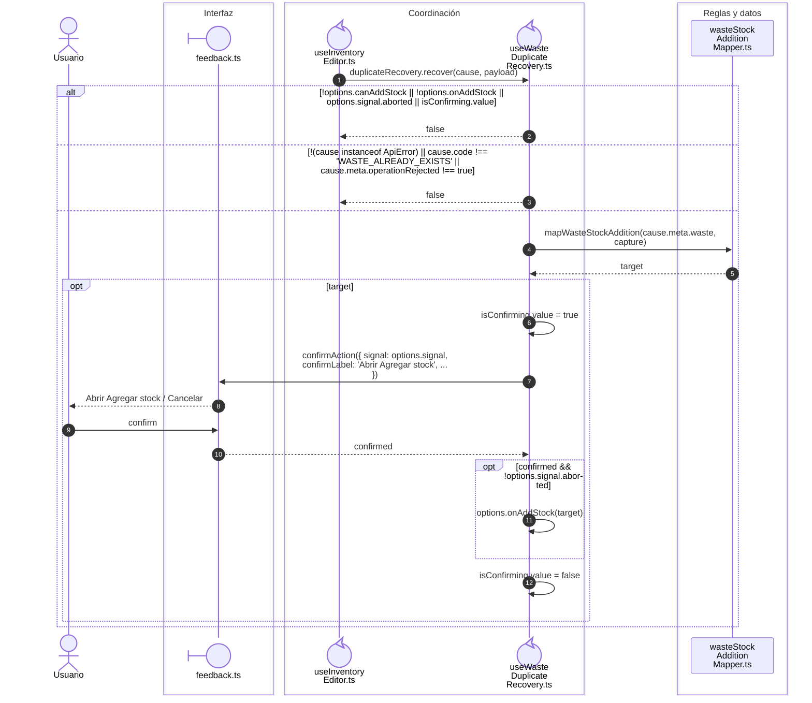
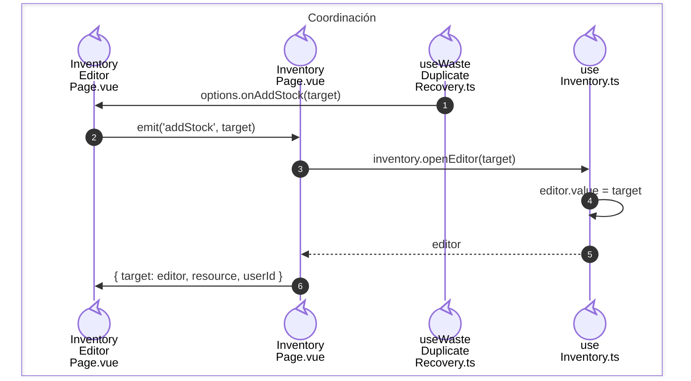

# Merma duplicada: apertura de una entrada

**Casos relacionados:** CU-ALM-10 A2 y CU-ALM-13.

## Secuencia aplicada

**Identificador:** `DIA-VUE-SEQ-009`.

## Entrega del destino de entrada

**Identificador:** `DIA-VUE-SEQ-048`.

## Fuentes de los participantes

[InventoryPage.vue](../../../../../src/modules/warehouse/pages/InventoryPage.vue),
[InventoryEditorPage.vue](../../../../../src/modules/warehouse/pages/InventoryEditorPage.vue),
[feedback.ts](../../../../../src/shared/ui/feedback.ts),
[useInventoryEditor.ts](../../../../../src/modules/warehouse/composables/useInventoryEditor.ts),
[useWasteDuplicateRecovery.ts](../../../../../src/modules/warehouse/composables/useWasteDuplicateRecovery.ts),
[useInventory.ts](../../../../../src/modules/warehouse/composables/useInventory.ts),
[wasteStockAdditionMapper.ts](../../../../../src/modules/warehouse/mappers/wasteStockAdditionMapper.ts).
