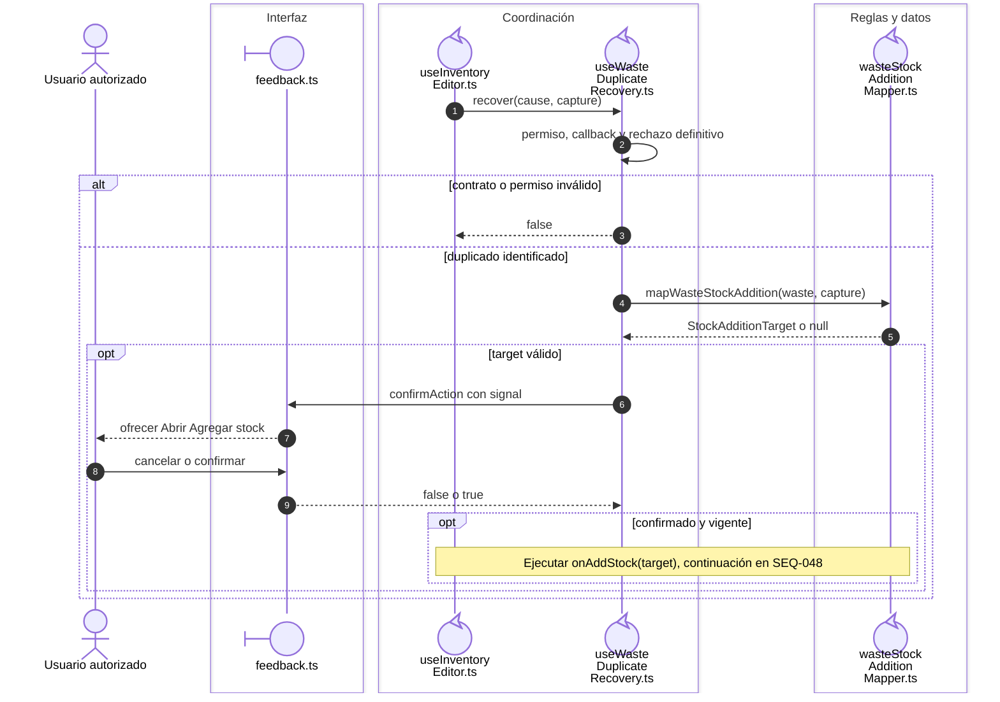
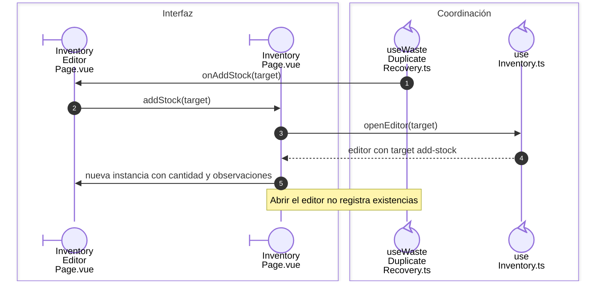

# Merma duplicada: apertura de una entrada

## Escenario y contratos

**Casos relacionados:** CU-ALM-10 A2 y CU-ALM-13.

## Secuencia aplicada

**Identificador:** `DIA-VUE-SEQ-009`.

**Lectura visual:** [líneas de vida, números y mensajes](../../diagram-reading.md#secuencias).

## Entrega del destino de entrada

**Identificador:** `DIA-VUE-SEQ-048`. Continúa la confirmación del aviso, conservando el propietario de cada evento y callback.

## Reglas y recuperación

Guardar el editor de entrada inicia otra operación con su propia clave y revisión. El ajuste absoluto no reemplaza esta entrada.

## Evidencia

wasteDuplicateRecoveryTest.ts y warehouse.spec.ts. La [matriz por caso](../../../../testing/04-use-case-coverage.md) identifica alcance y límites, y el [registro CP](../../../../testing/03-test-cases.md) concreta datos y oráculos críticos.

## Fuentes de los participantes

[InventoryPage.vue](../../../../../src/modules/warehouse/pages/InventoryPage.vue),
[InventoryEditorPage.vue](../../../../../src/modules/warehouse/pages/InventoryEditorPage.vue),
[feedback.ts](../../../../../src/shared/ui/feedback.ts),
[useInventoryEditor.ts](../../../../../src/modules/warehouse/composables/useInventoryEditor.ts),
[useWasteDuplicateRecovery.ts](../../../../../src/modules/warehouse/composables/useWasteDuplicateRecovery.ts),
[useInventory.ts](../../../../../src/modules/warehouse/composables/useInventory.ts),
[wasteStockAdditionMapper.ts](../../../../../src/modules/warehouse/mappers/wasteStockAdditionMapper.ts).
