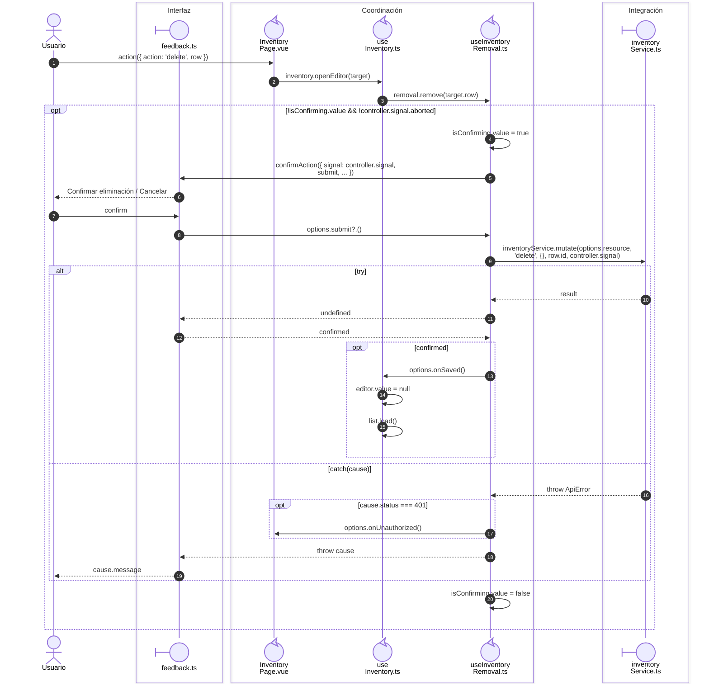

# Baja confirmada de una relación de inventario

## Secuencia aplicada

**Identificador:** `DIA-VUE-SEQ-021`.

## Fuentes de los participantes

[InventoryPage.vue](../../../../../src/modules/warehouse/pages/InventoryPage.vue),
[feedback.ts](../../../../../src/shared/ui/feedback.ts),
[useInventory.ts](../../../../../src/modules/warehouse/composables/useInventory.ts),
[useInventoryRemoval.ts](../../../../../src/modules/warehouse/composables/useInventoryRemoval.ts),
[inventoryService.ts](../../../../../src/modules/warehouse/services/inventoryService.ts).
