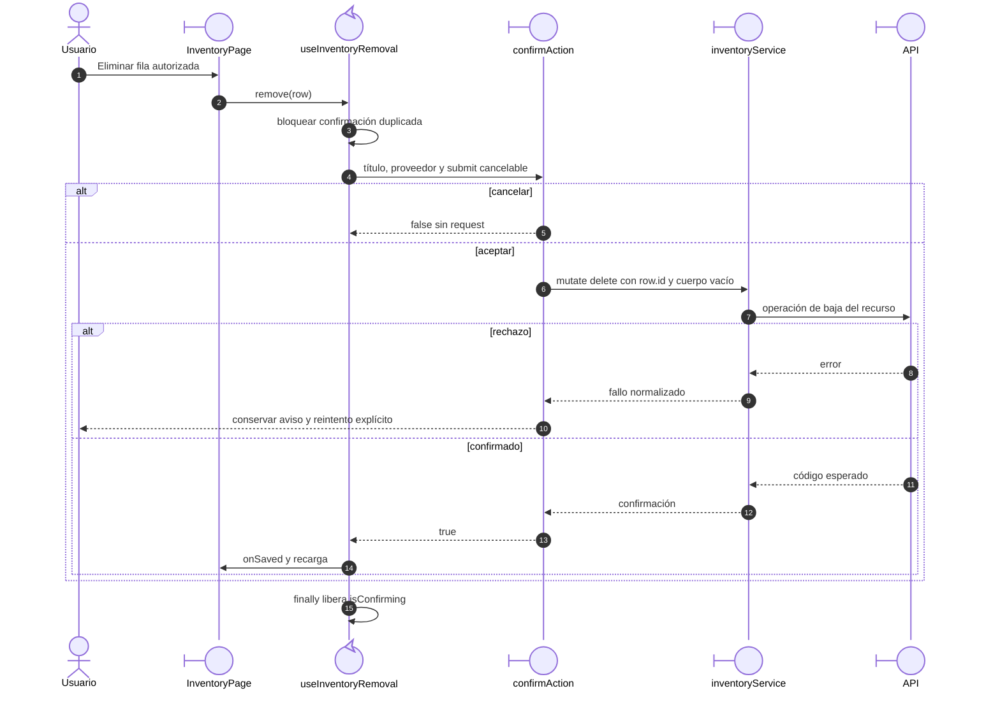

# Baja confirmada de una relación de inventario

## Escenario y fuente

Casos CU-ALM-04/14/20. Fuentes: `useInventoryRemoval.ts`, `inventoryService.mutate`
y `confirmAction`. La fila tiene ID de relación y entityId con significados distintos.

## Secuencia aplicada

**Identificador:** `DIA-VUE-SEQ-021`. Mensajes numerados y ramas de confirmación;
la API conserva el control definitivo de relaciones y efectos.

**Lectura visual:** [líneas de vida, números y mensajes](../../diagram-reading.md#secuencias).

## Protección y evidencia

El ID enviado es `row.id`, no `entityId`. Desmontar aborta el popup/solicitud; un 401
invoca recuperación de acceso. Cancelar o fallar no anuncia eliminación exitosa.
`warehouse.spec.ts`, pruebas de `feedback` y `inventoryService` conservan la evidencia
representativa; la eliminación persistente requiere API/base reales.
