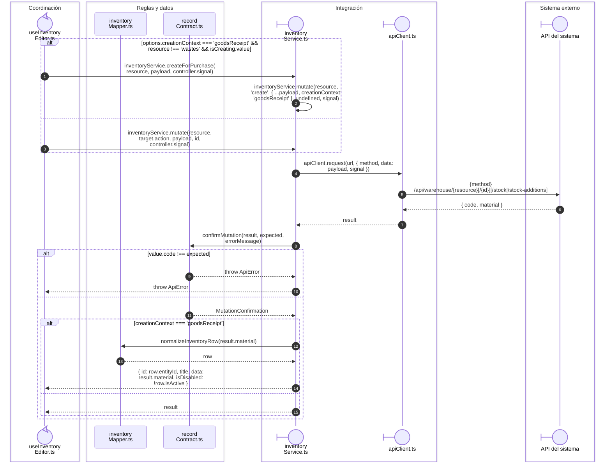

# Inventario: operación HTTP y alta de artículo para compra

## Operación y código del recurso

**Identificador:** `DIA-VUE-SEQ-040`.

## Fuentes de los participantes

[useInventoryEditor.ts](../../../../../src/modules/warehouse/composables/useInventoryEditor.ts),
[inventoryMapper.ts](../../../../../src/modules/warehouse/mappers/inventoryMapper.ts),
[recordContract.ts](../../../../../src/shared/http/recordContract.ts),
[inventoryService.ts](../../../../../src/modules/warehouse/services/inventoryService.ts),
[apiClient.ts](../../../../../src/shared/http/apiClient.ts).
