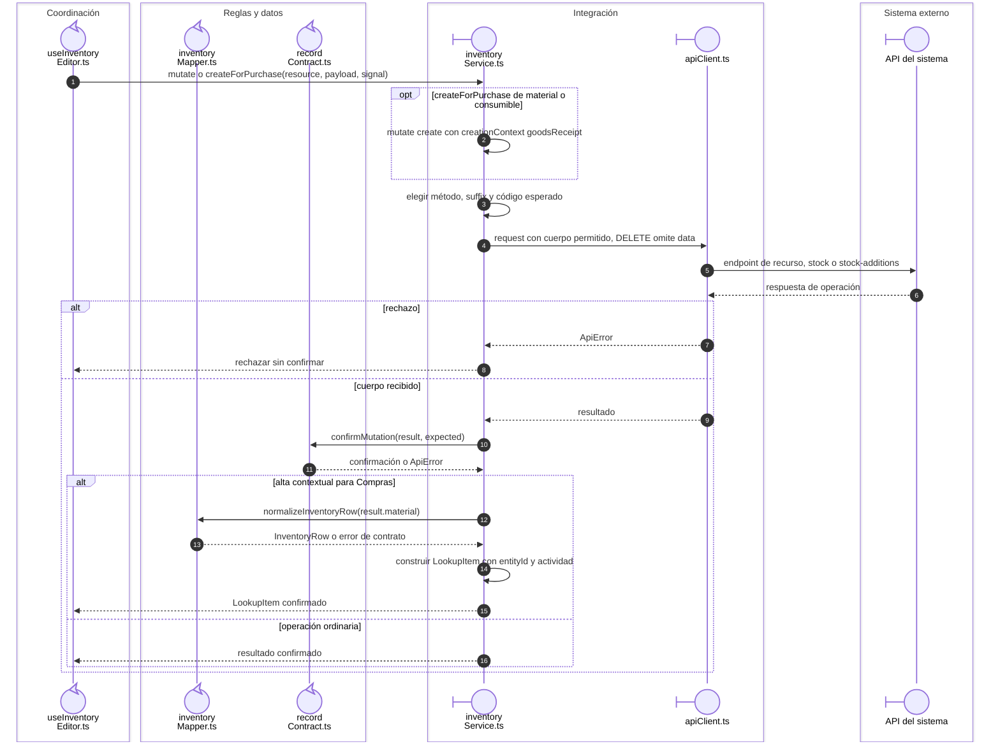

# Inventario: operación HTTP y alta de artículo para compra

Las operaciones `create`, `edit`, `stock`, `add-stock` y `delete` tienen endpoints
y cuerpos distintos. La confirmación precede al retorno de una opción creada.

## Operación y código del recurso

**Identificador:** `DIA-VUE-SEQ-040`. **Pregunta:** ¿Cómo se distingue una escritura de inventario de un alta auxiliar para Compras?

**Lectura visual:** [roles y callbacks](../00-reading-and-roles.md).

## Fuentes de los participantes

[useInventoryEditor.ts](../../../../../src/modules/warehouse/composables/useInventoryEditor.ts),
[inventoryMapper.ts](../../../../../src/modules/warehouse/mappers/inventoryMapper.ts),
[recordContract.ts](../../../../../src/shared/http/recordContract.ts),
[inventoryService.ts](../../../../../src/modules/warehouse/services/inventoryService.ts),
[apiClient.ts](../../../../../src/shared/http/apiClient.ts).
