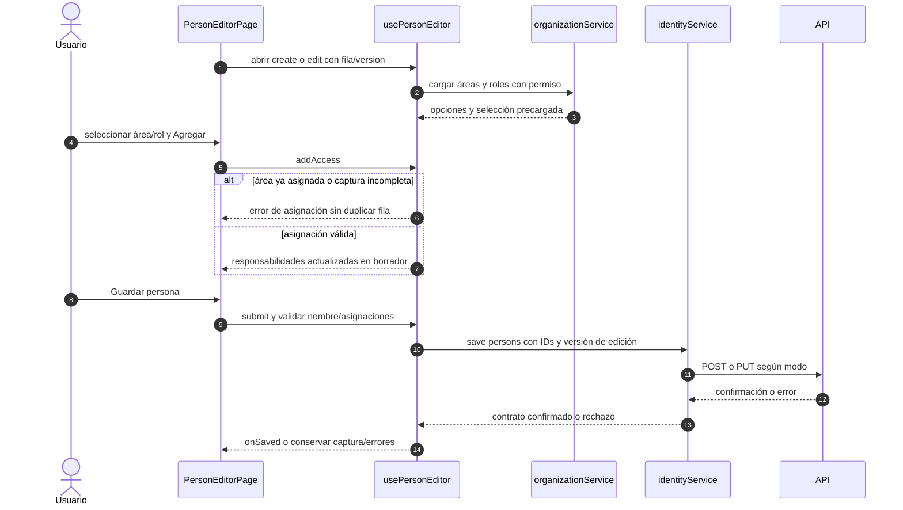

# Personas y responsabilidades

## Escenario y contratos

**Casos relacionados:** CU-IDA-02/03.

**Fuente técnica:** usePersonEditor.ts, organizationService.ts e identityService.ts. El diagrama describe el código Vue y sus fronteras. La API es un participante externo; sus transacciones internas no se atribuyen al navegador.

## Secuencia aplicada

**Identificador:** `DIA-VUE-SEQ-005`. Mensajes numerados; líneas continuas = invocación/solicitud, discontinuas = respuesta o resultado. Las ramas representan decisiones reales; no son ejecuciones simultáneas.

## Reglas y recuperación

Las responsabilidades son de la persona; no se envían etiquetas ni datos de cuenta. Quitar la última responsabilidad impide guardar. Las asignaciones de cuenta tienen una secuencia independiente.

## Evidencia

identityTest.ts y records.spec.ts. La [matriz por caso](../../../testing/04-use-case-coverage.md) identifica alcance y límites, y el [registro CP](../../../testing/03-test-cases.md) concreta datos y oráculos críticos.
