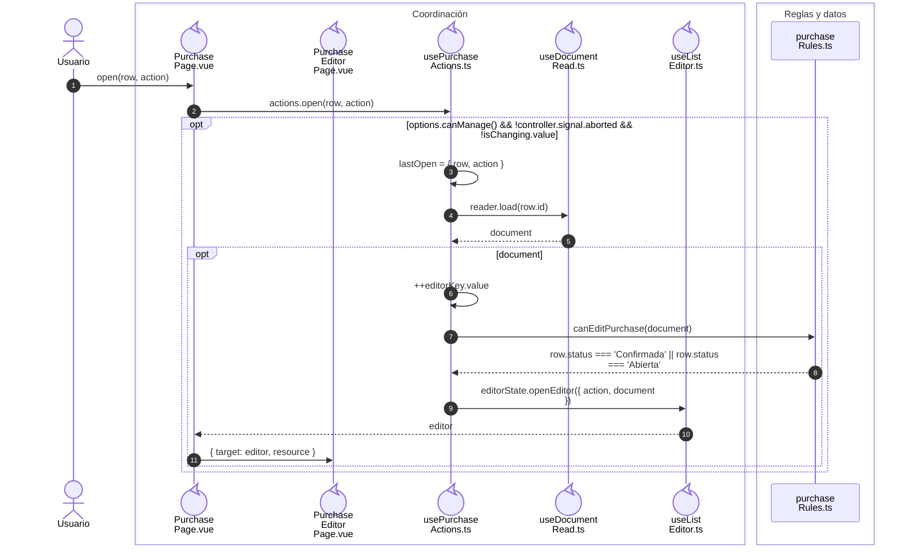

# Compra: lectura y preparación de detalles

**Casos relacionados:** CU-ENT-01/02/03/07/08/09.

## Secuencia aplicada

**Identificador:** `DIA-VUE-SEQ-011`.

## Fuentes de los participantes

[PurchasePage.vue](../../../../../src/modules/purchases/pages/PurchasePage.vue),
[PurchaseEditorPage.vue](../../../../../src/modules/purchases/pages/PurchaseEditorPage.vue),
[usePurchaseActions.ts](../../../../../src/modules/purchases/composables/usePurchaseActions.ts),
[useDocumentRead.ts](../../../../../src/shared/composables/useDocumentRead.ts),
[useListEditor.ts](../../../../../src/shared/composables/useListEditor.ts),
[purchaseRules.ts](../../../../../src/modules/purchases/purchaseRules.ts).

## Secuencias relacionadas

[DIA-VUE-SEQ-025](../02-shared-runtime/05-document-read.md#escenario-y-contratos).
