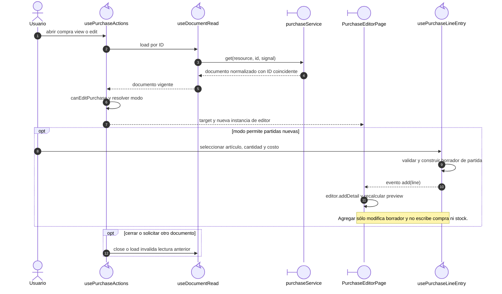

# Compra: lectura y preparación de partidas

## Escenario y contratos

**Casos relacionados:** CU-ENT-01/02/03/07/08/09.

**Fuente técnica:** usePurchaseActions.ts, useDocumentRead.ts, PurchaseEditorPage.vue y usePurchaseLineEntry.ts.

## Secuencia aplicada

**Identificador:** `DIA-VUE-SEQ-011`.

**Lectura visual:** [líneas de vida, números y mensajes](../../diagram-reading.md#secuencias).

## Reglas y recuperación

En alta se elige proveedor; en edición el proveedor persistido permanece fijo. La página conserva detalles recibidos separados de nuevas partidas. Una lectura fallida ofrece retry y no abre un editor con datos inventados.

## Evidencia

purchaseTest.ts y purchases.spec.ts. La [matriz por caso](../../../../testing/04-use-case-coverage.md) identifica alcance y límites, y el [registro CP](../../../../testing/03-test-cases.md) concreta datos y oráculos críticos.
