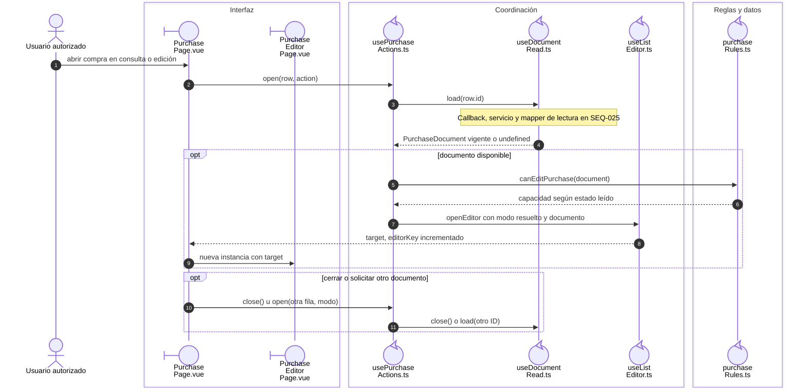

# Compra: lectura y preparación de partidas

## Escenario y contratos

**Casos relacionados:** CU-ENT-01/02/03/07/08/09.

## Secuencia aplicada

**Identificador:** `DIA-VUE-SEQ-011`.

**Lectura visual:** [líneas de vida, números y mensajes](../../diagram-reading.md#secuencias).

## Reglas y recuperación

El [agregado de partidas](05-purchase-line-entry.md) conserva una secuencia propia.

En alta se elige proveedor; en edición el proveedor persistido permanece fijo. La página conserva detalles recibidos separados de nuevas partidas. Una lectura fallida ofrece retry y no abre un editor con datos inventados.

## Evidencia

purchaseTest.ts y purchases.spec.ts. La [matriz por caso](../../../../testing/04-use-case-coverage.md) identifica alcance y límites, y el [registro CP](../../../../testing/03-test-cases.md) concreta datos y oráculos críticos.

## Fuentes de los participantes

[PurchasePage.vue](../../../../../src/modules/purchases/pages/PurchasePage.vue),
[PurchaseEditorPage.vue](../../../../../src/modules/purchases/pages/PurchaseEditorPage.vue),
[usePurchaseActions.ts](../../../../../src/modules/purchases/composables/usePurchaseActions.ts),
[useDocumentRead.ts](../../../../../src/shared/composables/useDocumentRead.ts),
[useListEditor.ts](../../../../../src/shared/composables/useListEditor.ts),
[purchaseRules.ts](../../../../../src/modules/purchases/purchaseRules.ts).
