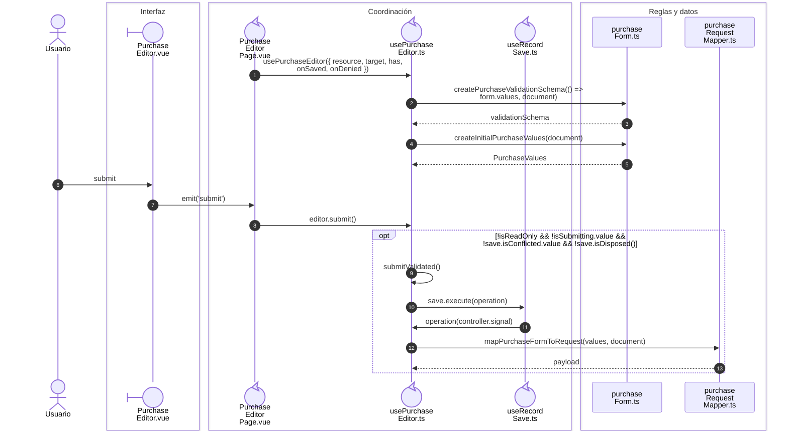
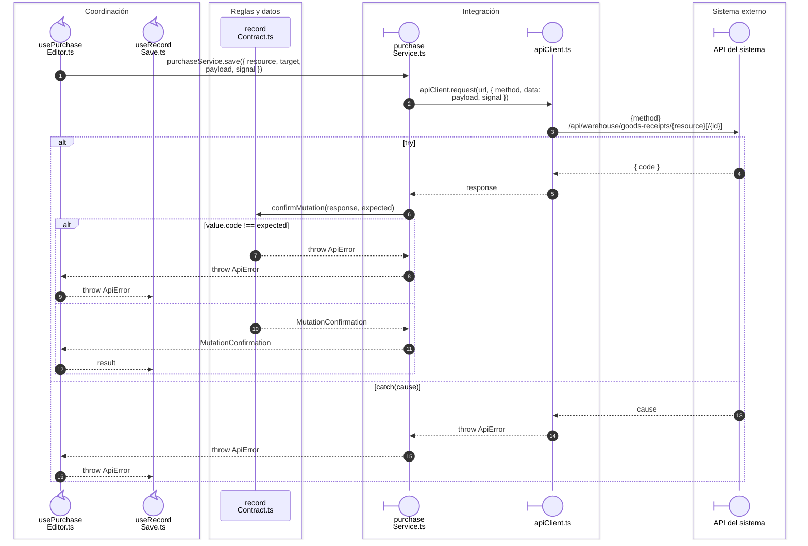
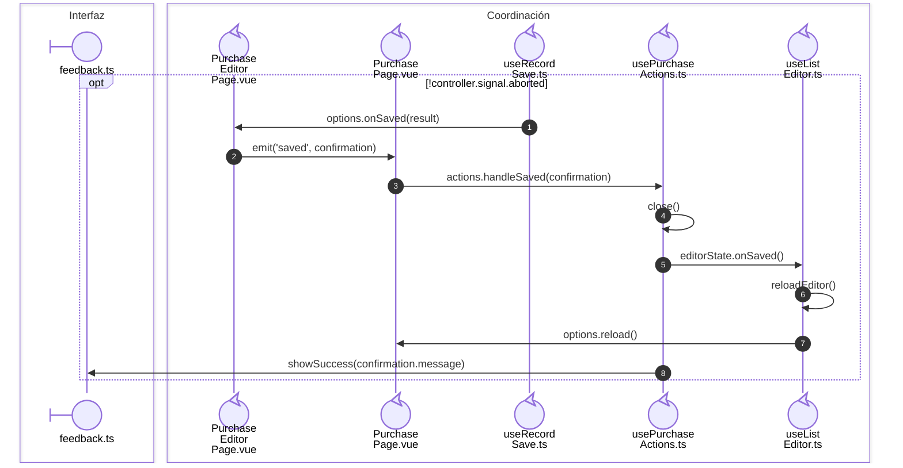

# Compra: alta y edición confirmadas

**Casos relacionados:** CU-ENT-02/03/08/09.

## Secuencia aplicada

**Identificador:** `DIA-VUE-SEQ-012`.

## Envío y resultado de la operación

**Identificador:** `DIA-VUE-SEQ-031`.

## Entrega del evento y actualización del listado

**Identificador:** `DIA-VUE-SEQ-041`.

## Fuentes de los participantes

[PurchaseEditor.vue](../../../../../src/modules/purchases/components/PurchaseEditor.vue),
[PurchaseEditorPage.vue](../../../../../src/modules/purchases/pages/PurchaseEditorPage.vue),
[usePurchaseEditor.ts](../../../../../src/modules/purchases/composables/usePurchaseEditor.ts),
[useRecordSave.ts](../../../../../src/shared/composables/useRecordSave.ts),
[purchaseForm.ts](../../../../../src/modules/purchases/purchaseForm.ts),
[purchaseRequestMapper.ts](../../../../../src/modules/purchases/mappers/purchaseRequestMapper.ts),
[recordContract.ts](../../../../../src/shared/http/recordContract.ts),
[purchaseService.ts](../../../../../src/modules/purchases/services/purchaseService.ts),
[apiClient.ts](../../../../../src/shared/http/apiClient.ts),
[PurchasePage.vue](../../../../../src/modules/purchases/pages/PurchasePage.vue),
[feedback.ts](../../../../../src/shared/ui/feedback.ts),
[usePurchaseActions.ts](../../../../../src/modules/purchases/composables/usePurchaseActions.ts),
[useListEditor.ts](../../../../../src/shared/composables/useListEditor.ts).

## Secuencias relacionadas

[DIA-VUE-SEQ-051](../02-shared-runtime/08-record-save.md).
