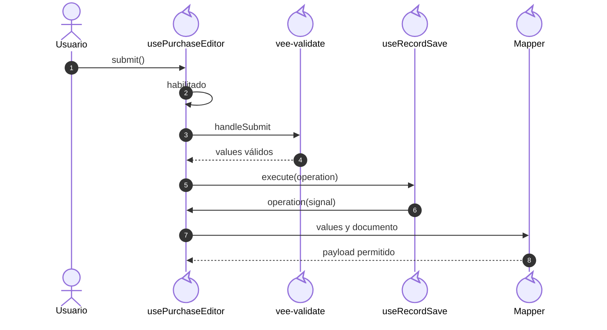
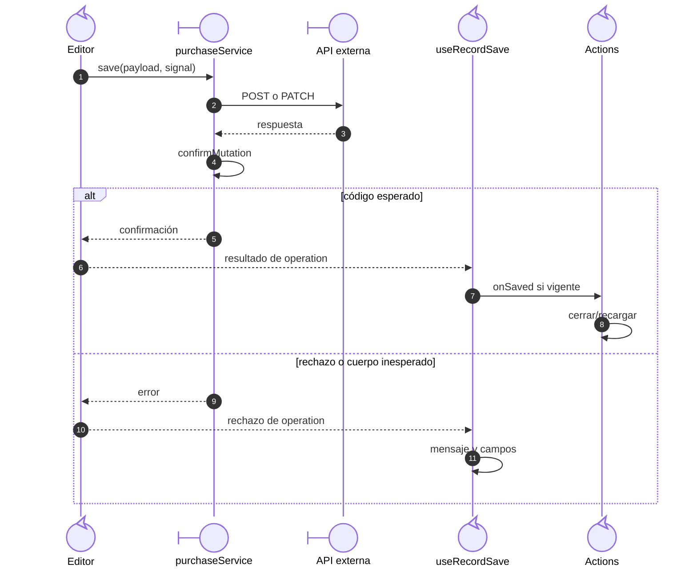

# Compra: alta y edición confirmadas

## Escenario y contratos

**Casos relacionados:** CU-ENT-02/03/08/09.

**Fuente técnica:** usePurchaseEditor.ts, purchaseRequestMapper.ts, purchaseService.save y usePurchaseActions.handleSaved.

## Secuencia aplicada

**Identificador:** `DIA-VUE-SEQ-012`.

**Lectura visual:** [líneas de vida, números y mensajes](../../diagram-reading.md#secuencias).

## Envío y resultado de la operación

**Identificador:** `DIA-VUE-SEQ-031`. **Pregunta:** ¿Cuándo se reconoce una compra
guardada y quién cierra la captura? **Fuentes:** `purchaseService.save`,
`confirmMutation`, `useRecordSave` y `usePurchaseActions.handleSaved`.
**Notación:** continuación del callback `operation(signal)` con respuesta alternativa.

| Condición anterior o posterior al envío | Comportamiento |
| --- | --- |
| Consulta, pendiente, conflicto o desmontado | `submit` no inicia otro guardado. |
| Formulario inválido | `handleSubmit` muestra errores y no ejecuta el callback válido. |
| Código confirmado | Cierra/recarga/avisa sólo si la señal del consumidor sigue vigente. |
| API 400 o campos rechazados | `useRecordSave` conserva captura y publica errores recibidos. |
| 401/403 | Comunica denegación al contenedor. |
| Error de red o confirmación inesperada | Conserva captura y presenta error; no anuncia éxito. |

## Cuerpo y confirmación

| Dato | Tratamiento en el cliente |
| --- | --- |
| Proveedor | En alta se toma de captura; en edición del documento leído. |
| Factura | Sólo se incluye si está facturada; recorta y convierte a mayúsculas. |
| Fecha/observaciones | Convierte fecha local a UTC y recorta observaciones. |
| Partidas | Envía sólo `materialId`, cantidad y costo de las `isNew`; en edición sin nuevas omite `details`. |
| Importes y totales | No se envían como autoridad; la API los calcula. |
| Identidad | El ID del documento determina el PATCH; corregir/cancelar detalle usa su flujo específico. |

El [modelo estático](../../logical/class-and-type-models/07-purchases.md) muestra
fila/documento/captura. La [lectura compartida](../02-shared-runtime/05-document-read.md)
protege la apertura; `useRecordSave` impide dos ejecuciones simultáneas y evita callbacks
después del desmontaje. Los límites de responsabilidad se conservan en
[guardado confirmado](../../development/design-and-construction-patterns/08-document-responsibilities.md#secuencia-de-guardado-confirmado).

## Reglas y recuperación

Las observaciones de encabezado se incluyen en lectura y escritura admitida; el historial de corrección no se sustituye por ese texto. La compra no contabiliza otra vez el alta contextual de un artículo.

## Evidencia

purchaseTest.ts, purchases.spec.ts y recordContractTest.ts. La [matriz por caso](../../../../testing/04-use-case-coverage.md) identifica alcance y límites, y el [registro CP](../../../../testing/03-test-cases.md) concreta datos y oráculos críticos.
