# Compra: corrección de un detalle

## Escenario y contratos

**Casos relacionados:** CU-ENT-04/10.

**Fuente técnica:** usePurchaseCorrection.ts y usePurchaseActions.handleDetailSaved.

## Secuencia aplicada

**Identificador:** `DIA-VUE-SEQ-013`.

**Lectura visual:** [líneas de vida, números y mensajes](../../diagram-reading.md#secuencias).

```mermaid
sequenceDiagram
    autonumber
    actor Usuario
    participant Actions@{ "type": "control" } as usePurchaseActions
    participant Correction@{ "type": "control" } as usePurchaseCorrection
    participant Feedback@{ "type": "boundary" } as confirmAction
    participant Service@{ "type": "boundary" } as purchaseService
    participant API@{ "type": "boundary" } as API
    Usuario->>Actions: Corregir detalle desde consulta
    Actions->>Actions: validar detalle activo, permiso y lectura vigente
    Actions-->>Correction: documento y detalle
    Usuario->>Correction: cambiar cantidad o costo y Guardar
    Correction->>Correction: validar captura, detectar cambio y preview
    alt captura igual o inválida
        Correction-->>Usuario: mensaje sin request
    else corrección válida
        Correction->>Feedback: confirmar nuevos totales estimados
        alt cancelar
            Feedback-->>Correction: false y captura conservada
        else aceptar
            Feedback-->>Correction: true
            Correction->>Service: changeDetail action correct
            Service->>API: PATCH details/id/corrections
            API-->>Service: respuesta de operación
            Service-->>Correction: confirmMutation o rechazo
            alt confirmado y vigente
                Correction->>Actions: handleDetailSaved
                Actions->>Actions: cerrar corrección, marcar needsReload y recargar
            else error
                Correction-->>Usuario: mantener diálogo y captura
            end
        end
    end
```

## Reglas y recuperación

La API resuelve stock, totales e historia; el diagrama no atribuye esa transacción al navegador. Tras confirmación se relee el documento antes de permitir otra modificación del detalle.

## Evidencia

purchaseTest.ts, purchases.spec.ts y CP-VUE-COM-003-01. La [matriz por caso](../../../../testing/04-use-case-coverage.md) identifica alcance y límites, y el [registro CP](../../../../testing/03-test-cases.md) concreta datos y oráculos críticos.
