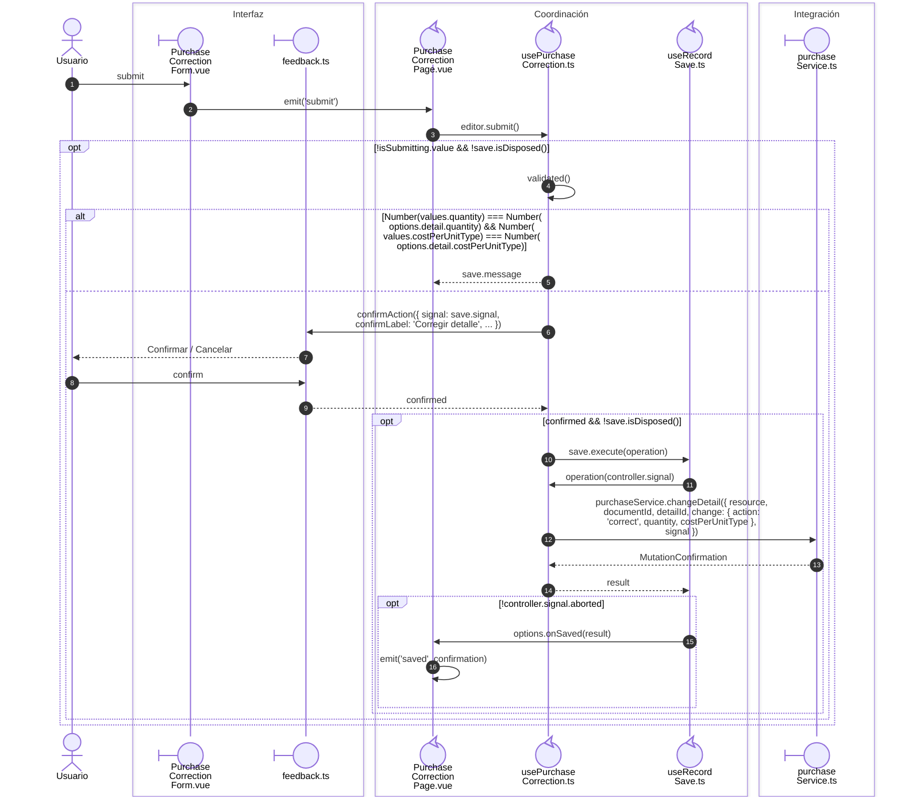

# Compra: corrección de un detalle

**Casos relacionados:** CU-ENT-04/10.

## Secuencia aplicada

**Identificador:** `DIA-VUE-SEQ-013`.

## Fuentes de los participantes

[PurchaseCorrectionForm.vue](../../../../../src/modules/purchases/components/PurchaseCorrectionForm.vue),
[PurchaseCorrectionPage.vue](../../../../../src/modules/purchases/pages/PurchaseCorrectionPage.vue),
[feedback.ts](../../../../../src/shared/ui/feedback.ts),
[usePurchaseCorrection.ts](../../../../../src/modules/purchases/composables/usePurchaseCorrection.ts),
[useRecordSave.ts](../../../../../src/shared/composables/useRecordSave.ts),
[purchaseService.ts](../../../../../src/modules/purchases/services/purchaseService.ts).

## Secuencias relacionadas

[DIA-VUE-SEQ-051](../02-shared-runtime/08-record-save.md).
