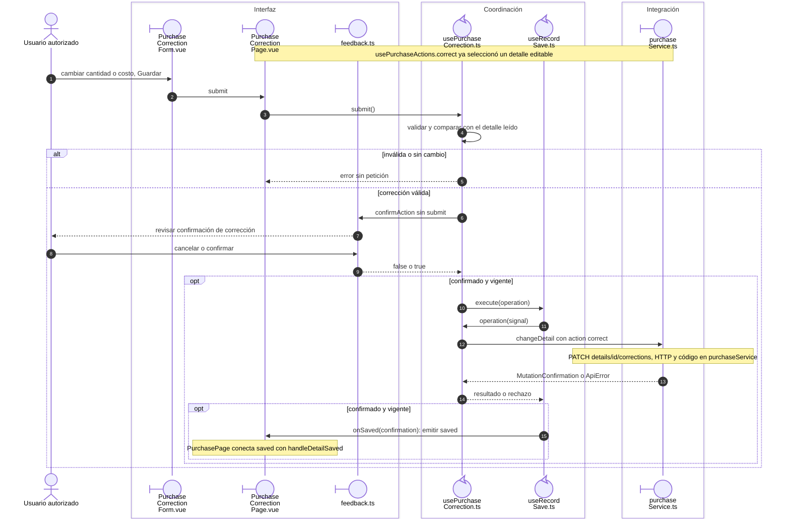

# Compra: corrección de un detalle

## Escenario y contratos

**Casos relacionados:** CU-ENT-04/10.

## Secuencia aplicada

**Identificador:** `DIA-VUE-SEQ-013`.

**Lectura visual:** [líneas de vida, números y mensajes](../../diagram-reading.md#secuencias).

## Reglas y recuperación

La API resuelve stock, totales e historia; el diagrama no atribuye esa transacción al navegador. Tras confirmación se relee el documento antes de permitir otra modificación del detalle.

## Evidencia

purchaseTest.ts, purchases.spec.ts y CP-VUE-COM-003-01. La [matriz por caso](../../../../testing/04-use-case-coverage.md) identifica alcance y límites, y el [registro CP](../../../../testing/03-test-cases.md) concreta datos y oráculos críticos.

## Fuentes de los participantes

[PurchaseCorrectionForm.vue](../../../../../src/modules/purchases/components/PurchaseCorrectionForm.vue),
[PurchaseCorrectionPage.vue](../../../../../src/modules/purchases/pages/PurchaseCorrectionPage.vue),
[feedback.ts](../../../../../src/shared/ui/feedback.ts),
[usePurchaseCorrection.ts](../../../../../src/modules/purchases/composables/usePurchaseCorrection.ts),
[useRecordSave.ts](../../../../../src/shared/composables/useRecordSave.ts),
[purchaseService.ts](../../../../../src/modules/purchases/services/purchaseService.ts).
