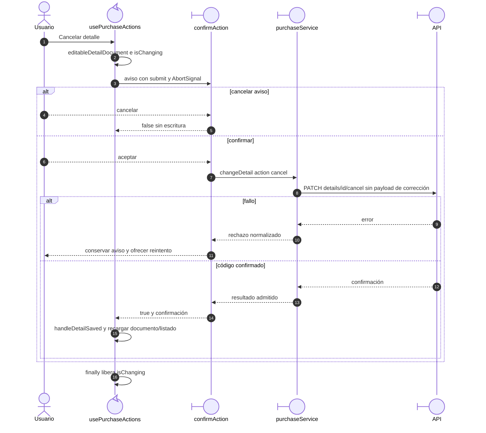

# Compra: cancelación y reintento explícito

## Escenario y contratos

**Casos relacionados:** CU-ENT-05/11.

**Fuente técnica:** usePurchaseActions.cancel y purchaseService.changeDetail.

## Secuencia aplicada

**Identificador:** `DIA-VUE-SEQ-014`.

**Lectura visual:** [líneas de vida, números y mensajes](../../diagram-reading.md#secuencias).

## Reglas y recuperación

Reintentar requiere otra acción del usuario sobre el aviso. Desmontar aborta la confirmación. La UI no marca el detalle cancelado antes de recibir el código esperado.

## Evidencia

purchases.spec.ts y pruebas de feedback. La [matriz por caso](../../../../testing/04-use-case-coverage.md) identifica alcance y límites, y el [registro CP](../../../../testing/03-test-cases.md) concreta datos y oráculos críticos.
