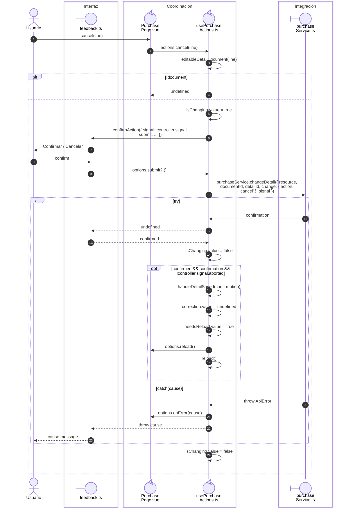

# Compra: cancelación y reintento explícito

**Casos relacionados:** CU-ENT-05/11.

## Secuencia aplicada

**Identificador:** `DIA-VUE-SEQ-014`.

## Fuentes de los participantes

[PurchasePage.vue](../../../../../src/modules/purchases/pages/PurchasePage.vue),
[feedback.ts](../../../../../src/shared/ui/feedback.ts),
[usePurchaseActions.ts](../../../../../src/modules/purchases/composables/usePurchaseActions.ts),
[purchaseService.ts](../../../../../src/modules/purchases/services/purchaseService.ts).
