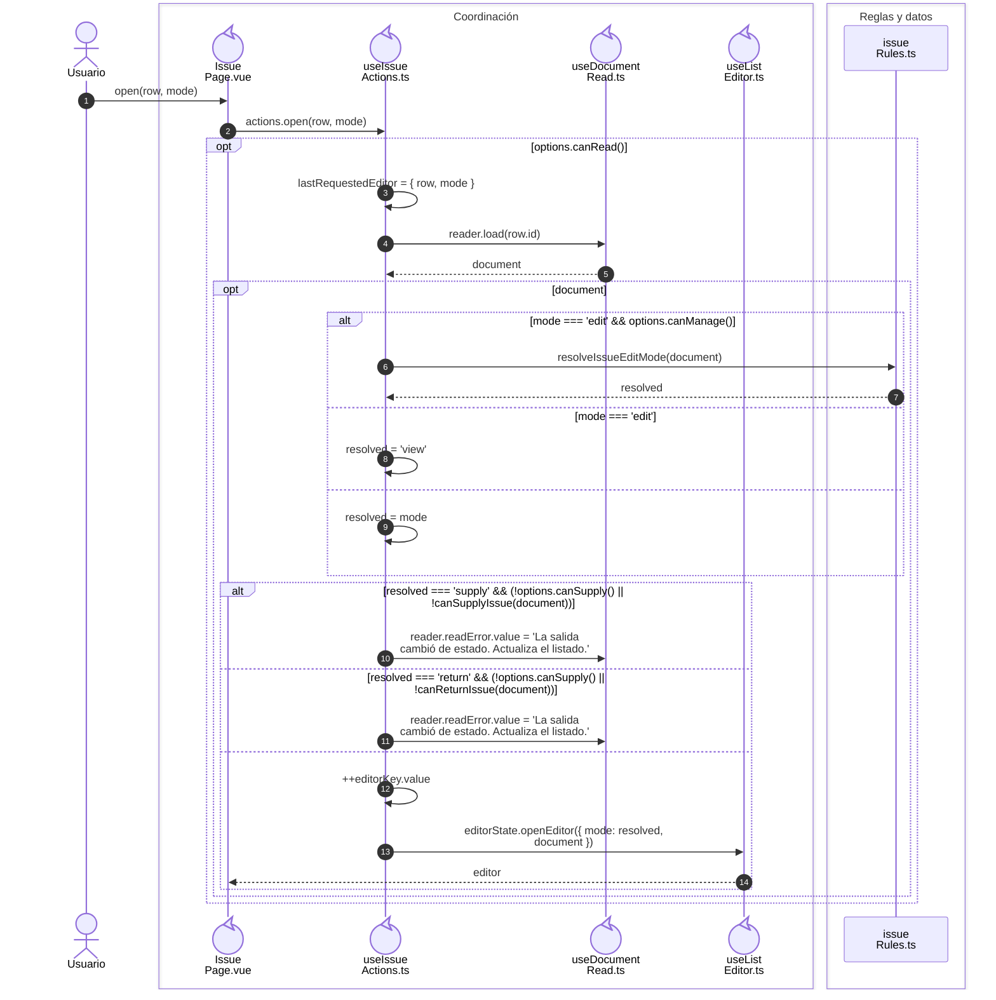
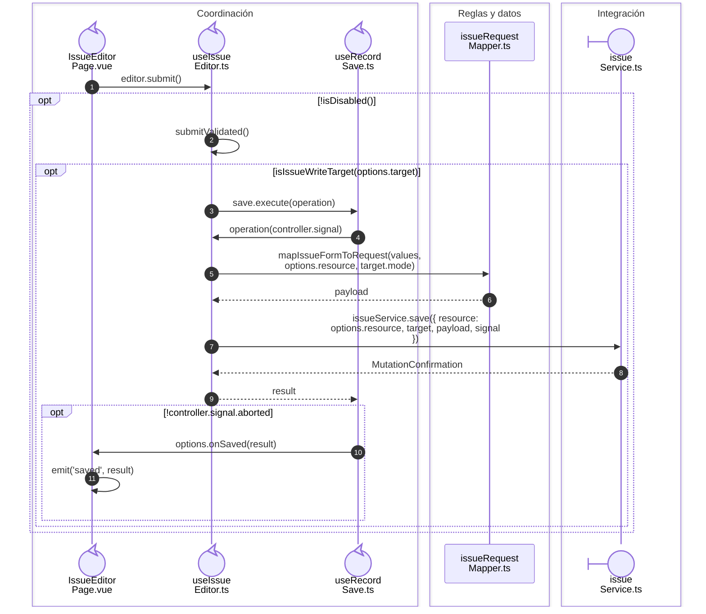

# Salida: apertura, modos y escritura

**Casos relacionados:** CU-SAL-02/03/04/09/10/11/16/17/18.

## Apertura y resolución del modo

**Identificador:** `DIA-VUE-SEQ-015`.

## Escritura de creación, edición y encabezado

**Identificador:** `DIA-VUE-SEQ-027`.

## Fuentes de los participantes

[IssuePage.vue](../../../../../src/modules/issues/pages/IssuePage.vue),
[useIssueActions.ts](../../../../../src/modules/issues/composables/useIssueActions.ts),
[useDocumentRead.ts](../../../../../src/shared/composables/useDocumentRead.ts),
[useListEditor.ts](../../../../../src/shared/composables/useListEditor.ts),
[issueRules.ts](../../../../../src/modules/issues/issueRules.ts),
[IssueEditorPage.vue](../../../../../src/modules/issues/pages/IssueEditorPage.vue),
[useIssueEditor.ts](../../../../../src/modules/issues/composables/useIssueEditor.ts),
[useRecordSave.ts](../../../../../src/shared/composables/useRecordSave.ts),
[issueRequestMapper.ts](../../../../../src/modules/issues/mappers/issueRequestMapper.ts),
[issueService.ts](../../../../../src/modules/issues/services/issueService.ts).

## Secuencias relacionadas

[DIA-VUE-SEQ-042](05-issue-read-transport.md#documento-solicitado-y-documento-recibido), [DIA-VUE-SEQ-045](07-issue-save-transport.md#endpoint-y-confirmación-de-la-operación), [DIA-VUE-DOC-002](../../development/design-and-construction-patterns/08-document-responsibilities.md#secuencia-de-guardado-confirmado), [DIA-VUE-SEQ-051](../02-shared-runtime/08-record-save.md).
