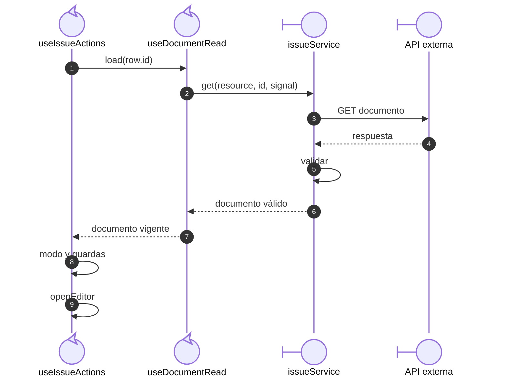
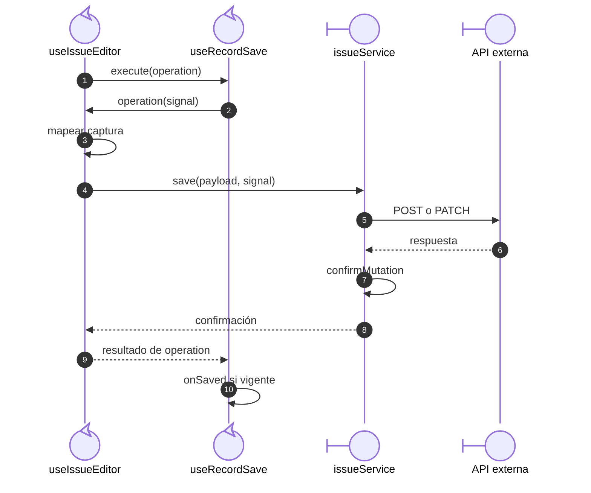

# Salida: apertura, modos y escritura

## Escenario y contratos

**Casos relacionados:** CU-SAL-02/03/04/09/10/11/16/17/18.

**Fuente técnica:** useIssueActions.ts, useIssueEditor.ts, issueRules.ts e issueRequestMapper.ts.

## Apertura y resolución del modo

**Identificador:** `DIA-VUE-SEQ-015`.

**Lectura visual:** [líneas de vida, números y mensajes](../../diagram-reading.md#secuencias).

## Decisiones de apertura

| Condición | Resultado |
| --- | --- |
| Sin lectura | `open` no inicia GET. |
| Lectura fallida o sustituida | No abre el editor; la lectura vigente presenta error y permite retry. |
| `edit` sin gestión | Resuelve `view`. |
| `edit` con gestión | `resolveIssueEditMode` decide `edit` o `header` sobre el documento leído. |
| `supply`/`return` sin capacidad o estado admitido | Publica error de estado y no abre el modo solicitado. |
| Modo admitido | Incrementa `editorKey` y abre el destino con el documento. |
| `create` | Requiere gestión y abre captura nueva sin lectura de documento. |

La figura muestra la lectura satisfactoria; la tabla y la
[lectura compartida](../02-shared-runtime/05-document-read.md) completan rechazo y reintento.

## Escritura de creación, edición y encabezado

**Identificador:** `DIA-VUE-SEQ-027`. **Pregunta:** ¿Quién decide qué datos salen
según el modo y cuándo se comunica el éxito? **Fuentes:** `useIssueEditor`,
`mapIssueFormToRequest`, `useRecordSave` e `issueService.save`.
**Notación:** secuencia de escritura con validación local y confirmación contractual.

La figura se concentra en create/edit/header. El modo supply reutiliza el coordinador
pero construye otro cuerpo y endpoint; su colaboración está en
[surtido](02-issue-supply.md). Return usa el
[flujo de devolución](03-issue-return.md). `create` abre una captura nueva sin GET previo;
`open` carga el documento antes de decidir el modo. La
[lectura compartida](../02-shared-runtime/05-document-read.md) detalla sustitución y aborto.

## Guardas y resultados del guardado

`submit` comprueba que el editor no sea de sólo lectura, no esté enviando, no tenga
conflicto y no esté desmontado. `handleSubmit` comprueba el esquema del modo y el
callback exige `isIssueWriteTarget`; sin valores válidos no se llama al servicio.
`useRecordSave` ejecuta el callback que construye el cuerpo, por eso la transformación
aparece después de `execute` en la secuencia.

El POST crea; PATCH utiliza el ID del documento y `/header` cuando corresponde.
`confirmMutation` exige el código de creación/edición del recurso de artículos o merma.
Un rechazo conserva captura y mensaje/errores; 401/403 comunican denegación. Sólo una
confirmación con consumidor vigente llama a `useIssueActions.handleSaved`, que cierra,
recarga el listado y presenta el mensaje recibido. La figura muestra el recorrido
confirmado; el [guardado compartido](../02-shared-runtime/01-list-and-record-save.md)
desarrolla conflicto, cancelación y rechazo.

## Reglas y recuperación

La selección dependiente de encabezado pertenece a useIssueHeaderSelection. Editar después de surtir no reescribe detalles protegidos. La API conserva la decisión definitiva de estado/pertenencia.

## Evidencia

issueTest.ts e issues.spec.ts. La [matriz por caso](../../../../testing/04-use-case-coverage.md) identifica alcance y límites, y el [registro CP](../../../../testing/03-test-cases.md) concreta datos y oráculos críticos.
