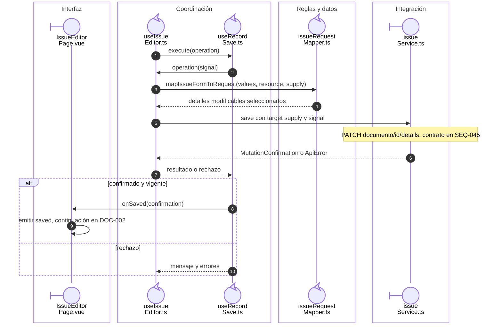

# Salida: selección y surtido

## Escenario y contratos

**Casos relacionados:** CU-SAL-05/12/19.

## Secuencia aplicada

**Identificador:** `DIA-VUE-SEQ-016`.

**Lectura visual:** [líneas de vida, números y mensajes](../../diagram-reading.md#secuencias).

```mermaid
sequenceDiagram
    autonumber
    actor U as Usuario autorizado
    box Interfaz
    participant Form@{ "type": "boundary" } as Issue<br/>Editor.vue
    participant Page@{ "type": "boundary" } as IssueEditor<br/>Page.vue
    end
    box Coordinación
    participant Editor@{ "type": "control" } as useIssue<br/>Editor.ts
    end
    box Reglas y datos
    participant Details@{ "type": "control" } as issue<br/>Details.ts
    end
    Note over Form,Details: Apertura y permiso de surtido comprobados en SEQ-015
    U->>Form: seleccionar detalle y cantidad de proyecto
    Form->>Page: supply(id, changes)
    Page->>Editor: updateDetailSupply(id, changes)
    Editor->>Details: updateIssueDetailSupply(details, id, changes)
    Details-->>Editor: borrador con detalles protegidos conservados
    U->>Form: Guardar surtido
    Form->>Page: submit
    Page->>Editor: submit()
    Editor->>Editor: validar selección y cantidades
    alt inválido
        Editor-->>Page: errors sin escritura
    else captura válida
        Note over Editor: Entrar en el coordinador de SEQ-049
    end
```

## Payload y guardado del surtido

**Identificador:** `DIA-VUE-SEQ-049`. Continúa el envío válido, con el callback definido por el editor.



## Reglas y recuperación

El encabezado queda bloqueado en este modo. Detalles originalmente surtidos/cancelados se protegen. El stock suficiente se vuelve a comprobar en la API y un rechazo no se anuncia como surtido completado.

## Evidencia

issueTest.ts, issues.spec.ts y CP-VUE-ISS-002-01. La [matriz por caso](../../../../testing/04-use-case-coverage.md) identifica alcance y límites, y el [registro CP](../../../../testing/03-test-cases.md) concreta datos y oráculos críticos.

## Fuentes de los participantes

[IssueEditor.vue](../../../../../src/modules/issues/components/IssueEditor.vue),
[IssueEditorPage.vue](../../../../../src/modules/issues/pages/IssueEditorPage.vue),
[useIssueEditor.ts](../../../../../src/modules/issues/composables/useIssueEditor.ts),
[useRecordSave.ts](../../../../../src/shared/composables/useRecordSave.ts),
[issueDetails.ts](../../../../../src/modules/issues/issueDetails.ts),
[issueRequestMapper.ts](../../../../../src/modules/issues/mappers/issueRequestMapper.ts),
[issueService.ts](../../../../../src/modules/issues/services/issueService.ts).
