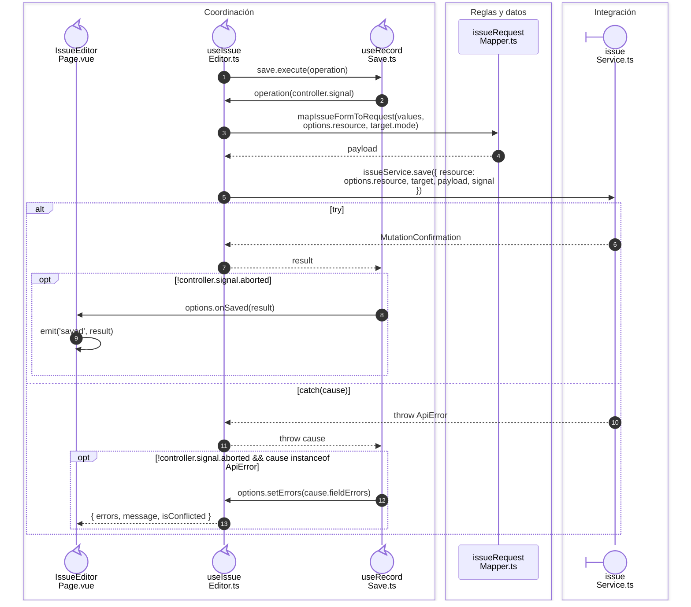

# Salida: selección y surtido

**Casos relacionados:** CU-SAL-05/12/19.

## Secuencia aplicada

**Identificador:** `DIA-VUE-SEQ-016`.

```mermaid
sequenceDiagram
    autonumber
    actor U as Usuario
    box Interfaz
    participant Form@{ "type": "boundary" } as Issue<br/>Editor.vue
    end
    box Coordinación
    participant Page@{ "type": "control" } as IssueEditor<br/>Page.vue
    participant Editor@{ "type": "control" } as useIssue<br/>Editor.ts
    end
    box Reglas y datos
    participant Details as issue<br/>Details.ts
    end
    U->>Form: nowrap: supply(id, changes)
    Form->>Page: nowrap: emit('supply', id, changes)
    Page->>Editor: nowrap: editor.updateDetailSupply(id, changes)
    opt nowrap: mode === 'supply'
        Editor->>Details: nowrap: updateIssueDetailSupply(<br/>form.values.details, id, changes)
        Details-->>Editor: nowrap: IssueDetail[]
        Editor->>Editor: nowrap: interaction.update('details', details)
    end
    U->>Form: nowrap: submit
    Form->>Page: nowrap: emit('submit')
    Page->>Editor: nowrap: editor.submit()
    opt nowrap: !isDisabled()
        Editor->>Editor: nowrap: submitValidated()
    end
```

## Payload y guardado del surtido

**Identificador:** `DIA-VUE-SEQ-049`.



## Fuentes de los participantes

[IssueEditor.vue](../../../../../src/modules/issues/components/IssueEditor.vue),
[IssueEditorPage.vue](../../../../../src/modules/issues/pages/IssueEditorPage.vue),
[useIssueEditor.ts](../../../../../src/modules/issues/composables/useIssueEditor.ts),
[useRecordSave.ts](../../../../../src/shared/composables/useRecordSave.ts),
[issueDetails.ts](../../../../../src/modules/issues/issueDetails.ts),
[issueRequestMapper.ts](../../../../../src/modules/issues/mappers/issueRequestMapper.ts),
[issueService.ts](../../../../../src/modules/issues/services/issueService.ts).

## Secuencias relacionadas

[DIA-VUE-SEQ-015](01-issue-open-save.md#apertura-y-resolución-del-modo), [DIA-VUE-SEQ-045](07-issue-save-transport.md#endpoint-y-confirmación-de-la-operación), [DIA-VUE-DOC-002](../../development/design-and-construction-patterns/08-document-responsibilities.md#secuencia-de-guardado-confirmado), [DIA-VUE-SEQ-051](../02-shared-runtime/08-record-save.md).
