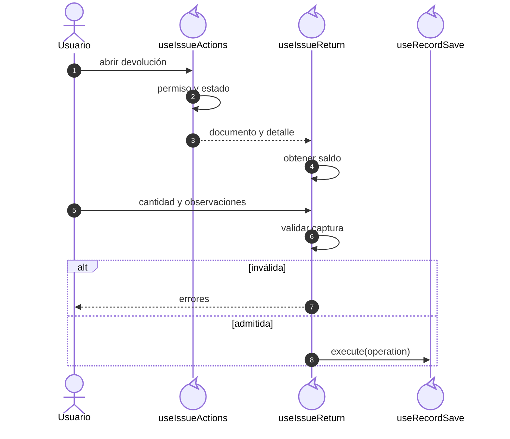
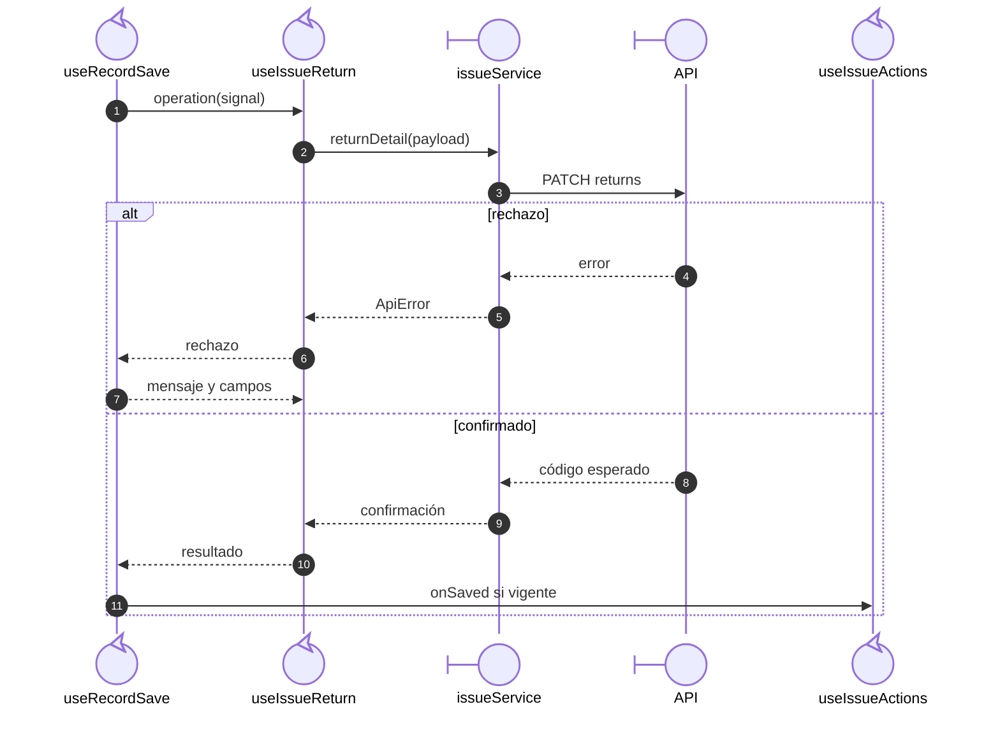

# Salida: devolución por saldo leído

## Escenario y contratos

**Casos relacionados:** CU-SAL-06/13/20.

**Fuente técnica:** useIssueReturn.ts, getIssueReturnableQuantity e issueService.returnDetail.

## Secuencia aplicada

**Identificador:** `DIA-VUE-SEQ-017`.

**Lectura visual:** [líneas de vida, números y mensajes](../../diagram-reading.md#secuencias).

## Ejecución del callback y resultado

**Identificador:** `DIA-VUE-SEQ-032`. **Pregunta:** ¿Quién construye la devolución
y cuándo se comunica la confirmación? **Fuente:** `useIssueReturn`, `useRecordSave`
e `issueService.returnDetail`. Secuencia del callback después de validar.

`useIssueReturn` construye IDs de documento/detalle, `returnQuantity` numérica y
observaciones recortadas. El coordinador compartido ejecuta el callback y presenta
sus errores; no importa el servicio de Salidas. La confirmación permite cerrar,
recargar y avisar desde el consumidor.

## Reglas y recuperación

La frontera local usa el saldo leído y no reserva inventario. La API comprueba el saldo vigente, la pertenencia del detalle y el movimiento inverso; la solicitud no reutiliza el guardado general de documento.

## Evidencia

issueTest.ts, issues.spec.ts y CP-VUE-ISS-002-02/03. La [matriz por caso](../../../../testing/04-use-case-coverage.md) identifica alcance y límites, y el [registro CP](../../../../testing/03-test-cases.md) concreta datos y oráculos críticos.
