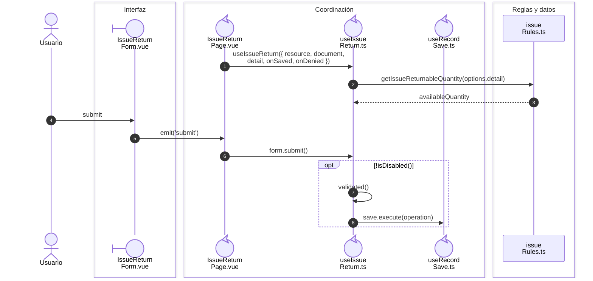
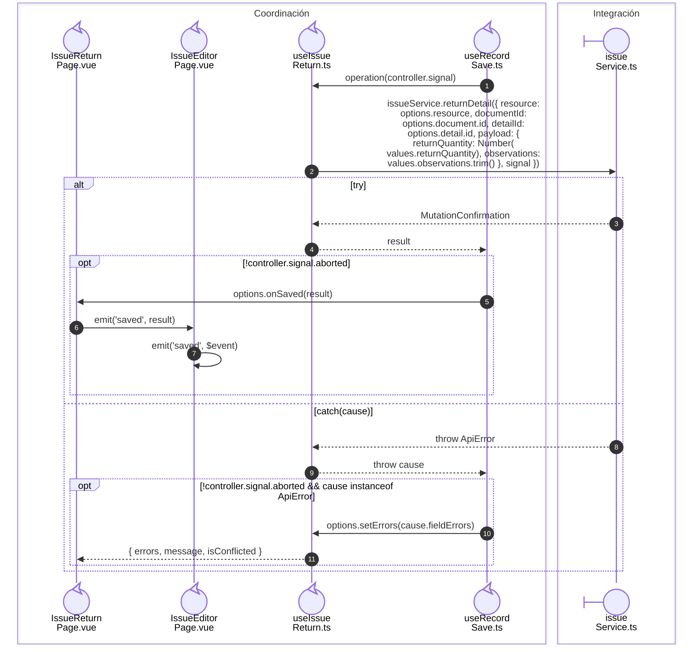

# Salida: devolución por saldo leído

**Casos relacionados:** CU-SAL-06/13/20.

## Secuencia aplicada

**Identificador:** `DIA-VUE-SEQ-017`.

## Ejecución del callback y resultado

**Identificador:** `DIA-VUE-SEQ-032`.

## Fuentes de los participantes

[IssueReturnForm.vue](../../../../../src/modules/issues/components/IssueReturnForm.vue),
[IssueReturnPage.vue](../../../../../src/modules/issues/pages/IssueReturnPage.vue),
[useIssueReturn.ts](../../../../../src/modules/issues/composables/useIssueReturn.ts),
[useRecordSave.ts](../../../../../src/shared/composables/useRecordSave.ts),
[issueRules.ts](../../../../../src/modules/issues/issueRules.ts),
[IssueEditorPage.vue](../../../../../src/modules/issues/pages/IssueEditorPage.vue),
[issueService.ts](../../../../../src/modules/issues/services/issueService.ts).

## Secuencias relacionadas

[DIA-VUE-SEQ-051](../02-shared-runtime/08-record-save.md), [DIA-VUE-SEQ-052](07-issue-save-transport.md#returndetailoptions), [DIA-VUE-DOC-002](../../development/design-and-construction-patterns/08-document-responsibilities.md#secuencia-de-guardado-confirmado).
