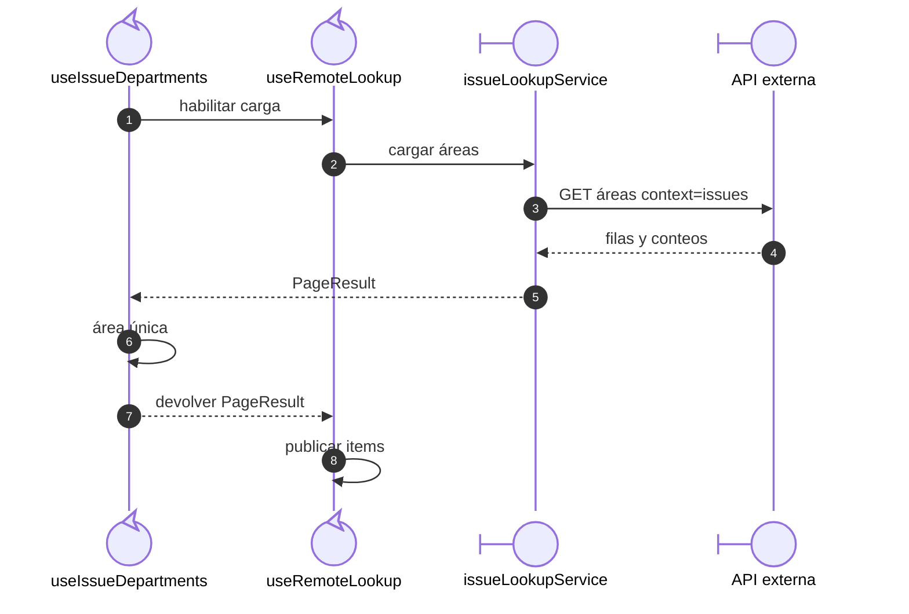
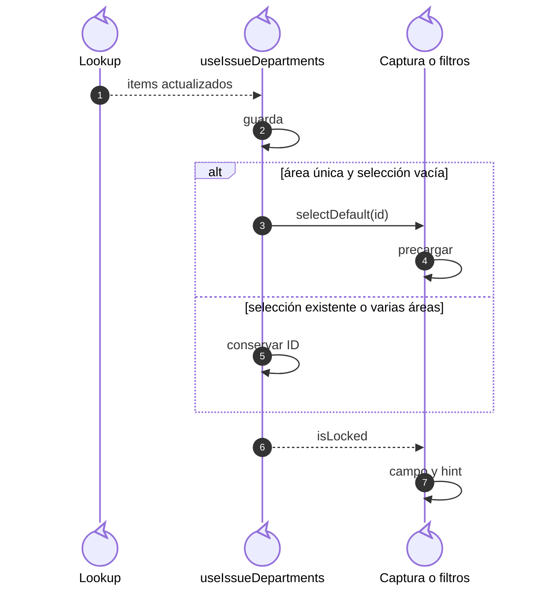

# Alcance de área: selección inicial y campo bloqueado

## Escenario y contratos

**Identificador:** `DIA-VUE-SEQ-026`. **Pregunta:** ¿Cómo se adapta el área de
filtro/captura al alcance real sin inferirlo desde el nombre del rol?
**Casos relacionados:** consulta y creación de CU-SAL; RN de autorización y selección.
**Fuentes:** [useIssueDepartments.ts](../../../../../src/modules/issues/composables/useIssueDepartments.ts),
[useIssueHeaderSelection.ts](../../../../../src/modules/issues/composables/useIssueHeaderSelection.ts),
[useIssueFilters.ts](../../../../../src/modules/issues/composables/useIssueFilters.ts),
[issueLookupService.ts](../../../../../src/modules/issues/services/issueLookupService.ts).
**Notación:** secuencia; el total del catálogo sin búsqueda determina la adaptación visual,
no una autorización independiente de la API.

**Lectura visual:** [líneas de vida, números y mensajes](../../diagram-reading.md#secuencias).

## Adaptación de captura y filtros

**Identificador:** `DIA-VUE-SEQ-030`. **Pregunta:** ¿Cuándo se preselecciona,
bloquea y conserva el área? **Fuente:** el watch de `useIssueDepartments` y sus callbacks
de encabezado/filtros. **Notación:** colaboración reactiva después de publicar opciones.

| Decisión | Condición exacta |
| --- | --- |
| Alcance único | Página 1 sin búsqueda, señal vigente, `recordsFiltered === 1`, una fila y no deshabilitada. |
| Preselección | Habilitado, área única ya incluida en `items` y selección vacía. |
| Callback de encabezado | Asigna sólo cuando no hay documento, conservando el área en edición. |
| Bloqueo | Existe área única y `getSelectedId()` coincide con ella; se combina con otras restricciones del campo. |
| Limpieza de filtros | Conserva `departmentId` si bloqueado y reinicia los otros campos/búsquedas. |
| Búsqueda paginada | No redefine el alcance por encontrar una única coincidencia. |

El request completo del catálogo usa `/api/admin/departments?context=issues` con
búsqueda vacía y página inicial. La instantánea se calcula en el callback que espera
el servicio, antes de que `useRemoteLookup` publique `items`. El watch espera la opción
publicada antes de invocar el callback; no representa una llamada HTTP adicional.

## Decisiones y rechazo

Esperar a `lookup.items` conserva la etiqueta y evita mostrar temporalmente el UUID.
Si falla el catálogo, el selector presenta error/reintento y no inventa un área
predeterminada. Las capacidades del formulario pueden deshabilitar el campo por otros
motivos, además de `isLocked`.

La política de cuenta y alcance se comprueba en la API para consulta y escritura,
incluso si una solicitud manipulada cambia `departmentId`. El cliente sólo adapta
la interacción al catálogo autorizado. La figura no concede surtidos ni devoluciones
a las áreas operativas. La evidencia del cliente está en
[issueDepartmentsTest.ts](../../../../../tests/unit/modules/issues/issueDepartmentsTest.ts);
el [dominio](../../../../requirements/domain-model/01-identity-and-organization.md)
explica cuenta, persona y asignaciones.
