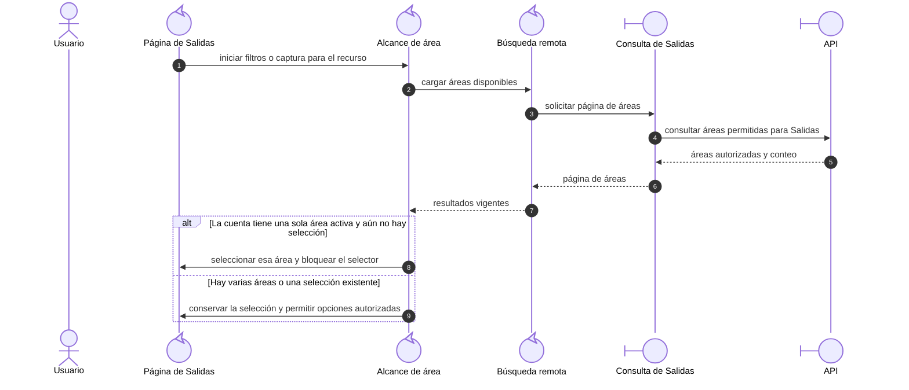
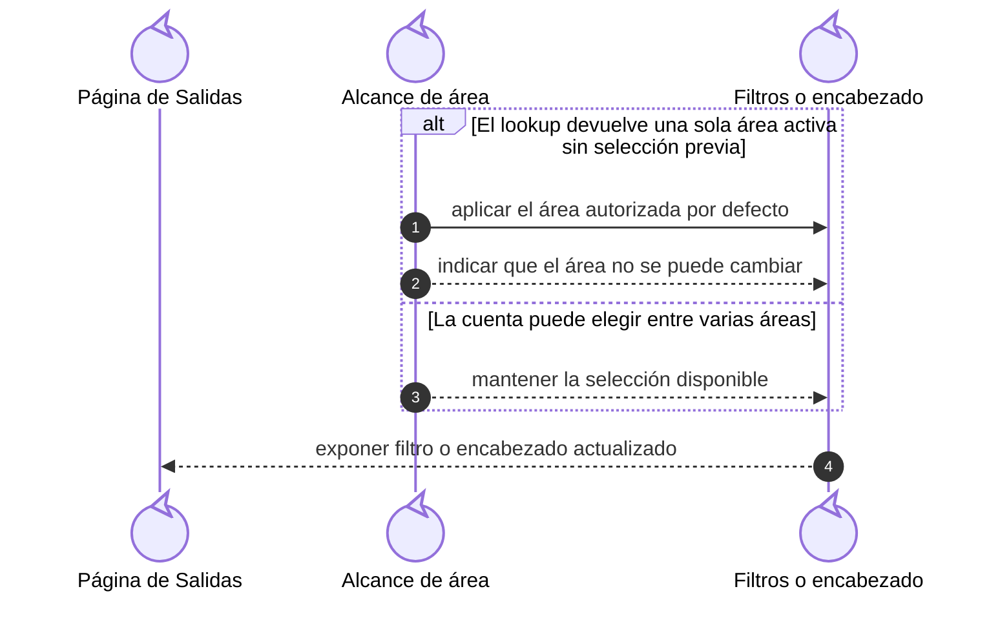

# Alcance de área en consultas y capturas

**Pregunta:** ¿cómo aplica Vue el área autorizada en filtros y documentos de Salidas?
**Casos relacionados:** `CU-SAL-01..05`, `CU-SAL-08..12`, `CU-SAL-15..20`.

## Selección inicial

**Identificador:** `DIA-VUE-SEQ-026`.

## Aplicación a filtros y encabezado

**Identificador:** `DIA-VUE-SEQ-030`.

El API determina las áreas que se pueden consultar y validar; la selección visual sólo
preselecciona y bloquea el selector cuando corresponde. El alcance enviado por el
cliente no sustituye la autorización del servidor.

## Fuentes

[useIssueDepartments.ts](../../../../../src/modules/issues/composables/useIssueDepartments.ts),
[useIssueFilters.ts](../../../../../src/modules/issues/composables/useIssueFilters.ts),
[useIssueHeaderSelection.ts](../../../../../src/modules/issues/composables/useIssueHeaderSelection.ts),
[issueLookupService.ts](../../../../../src/modules/issues/services/issueLookupService.ts),
[useRemoteLookup.ts](../../../../../src/shared/composables/useRemoteLookup.ts).
