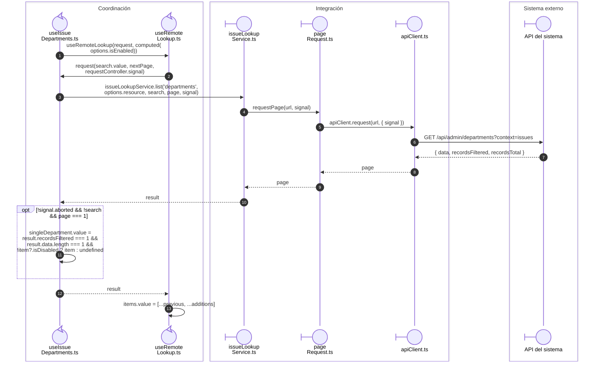
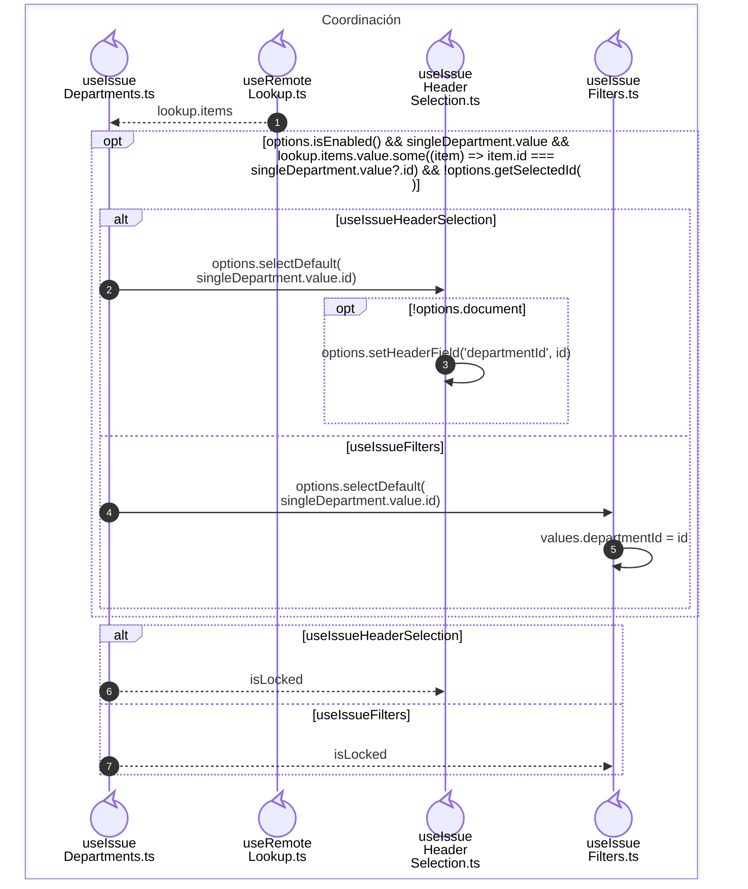

# Alcance de área: selección inicial y campo bloqueado

**Casos relacionados:** consulta y creación de CU-SAL; RN de autorización y selección.

## Escenario y contratos

**Identificador:** `DIA-VUE-SEQ-026`.

## Adaptación de captura y filtros

**Identificador:** `DIA-VUE-SEQ-030`.

## Fuentes de los participantes

[useIssueDepartments.ts](../../../../../src/modules/issues/composables/useIssueDepartments.ts),
[useRemoteLookup.ts](../../../../../src/shared/composables/useRemoteLookup.ts),
[issueLookupService.ts](../../../../../src/modules/issues/services/issueLookupService.ts),
[pageRequest.ts](../../../../../src/shared/http/pageRequest.ts),
[apiClient.ts](../../../../../src/shared/http/apiClient.ts),
[useIssueHeaderSelection.ts](../../../../../src/modules/issues/composables/useIssueHeaderSelection.ts),
[useIssueFilters.ts](../../../../../src/modules/issues/composables/useIssueFilters.ts).
