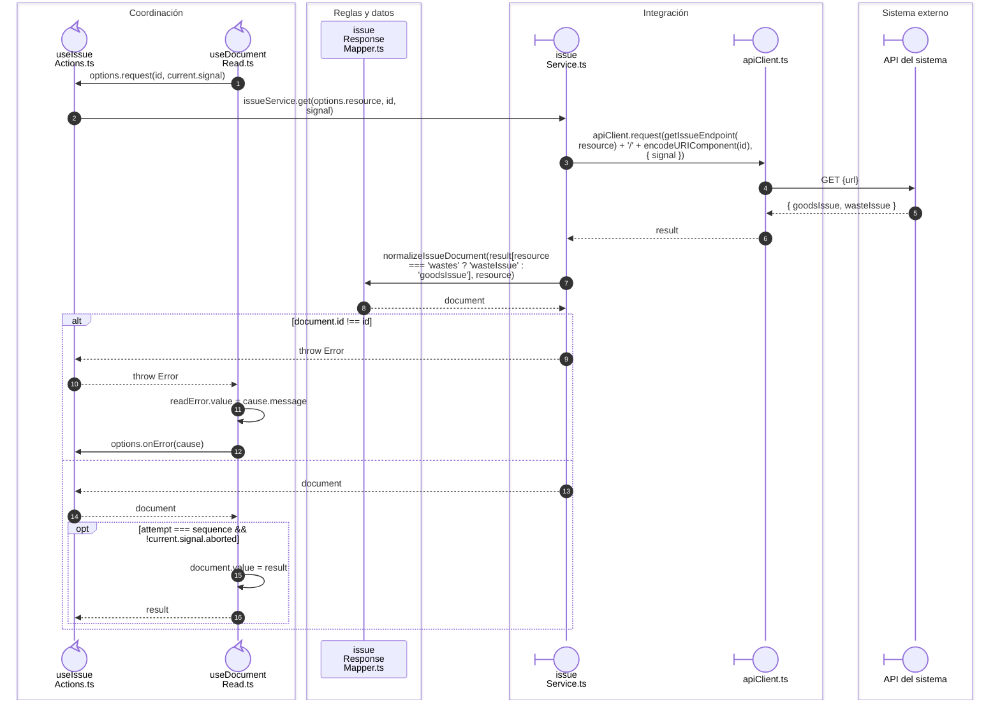

# Salida: lectura y adaptación del documento

## Documento solicitado y documento recibido

**Identificador:** `DIA-VUE-SEQ-042`.

## Fuentes de los participantes

[useIssueActions.ts](../../../../../src/modules/issues/composables/useIssueActions.ts),
[useDocumentRead.ts](../../../../../src/shared/composables/useDocumentRead.ts),
[issueResponseMapper.ts](../../../../../src/modules/issues/mappers/issueResponseMapper.ts),
[issueService.ts](../../../../../src/modules/issues/services/issueService.ts),
[apiClient.ts](../../../../../src/shared/http/apiClient.ts).

## Secuencias relacionadas

[DIA-VUE-SEQ-015](01-issue-open-save.md#apertura-y-resolución-del-modo).
