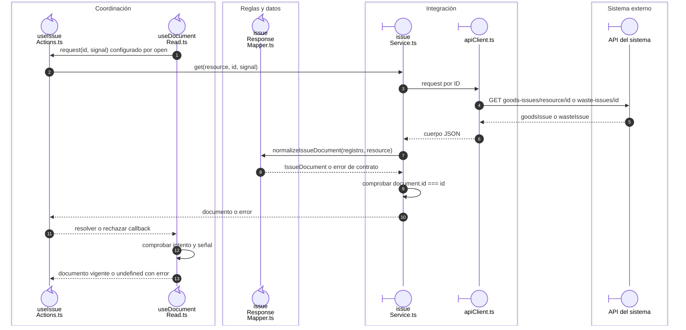

# Salida: lectura y adaptación del documento

La apertura de `SEQ-015` configura el callback de lectura en `useIssueActions`.
El lector compartido protege la vigencia; el servicio comprueba la identidad recibida.

## Documento solicitado y documento recibido

**Identificador:** `DIA-VUE-SEQ-042`. **Pregunta:** ¿Qué colaboradores convierten una respuesta HTTP en IssueDocument?

**Lectura visual:** [roles y callbacks](../00-reading-and-roles.md).

## Fuentes de los participantes

[useIssueActions.ts](../../../../../src/modules/issues/composables/useIssueActions.ts),
[useDocumentRead.ts](../../../../../src/shared/composables/useDocumentRead.ts),
[issueResponseMapper.ts](../../../../../src/modules/issues/mappers/issueResponseMapper.ts),
[issueService.ts](../../../../../src/modules/issues/services/issueService.ts),
[apiClient.ts](../../../../../src/shared/http/apiClient.ts).
